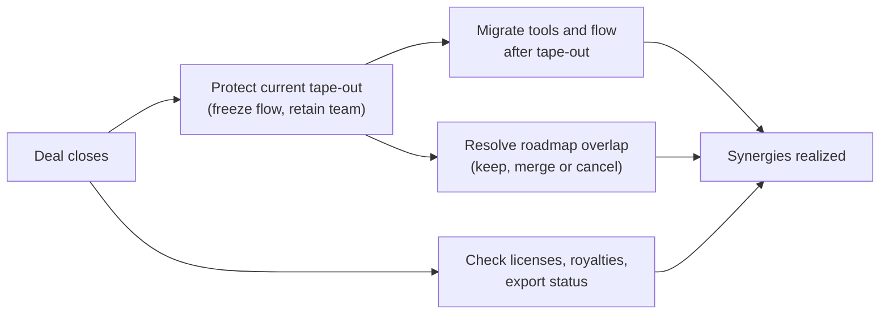

<!-- status: verified -->
# 28-08 · Post-Acquisition Integration Risk

| | |
|---|---|
| **Course** | [28 · Technical Diligence and Engineering Leadership Fluency](../README.md) |
| **University equivalent** | No direct university equivalent. It applies corporate-finance valuation of synergies (annuities and discounting, as in a business-school corporate finance course), real-options reasoning about parallel development paths, and expected-loss risk registers from project management to the engineering side of semiconductor acquisitions |
| **Prerequisites** | [28-07](28-07-evaluating-engineering-teams.md) (retention and bench depth), [28-01](28-01-technology-evaluation-framework.md) (earn-outs and milestone chains), [26-04](../../26-engineering-design-and-professional-practice/chapters/26-04-engineering-economics-2.md) (discounting and annuities), [26-05](../../26-engineering-design-and-professional-practice/chapters/26-05-schedule-and-respin-risk.md) (risk registers), [28-02](28-02-validating-claims.md) (total processing performance) |
| **Estimated study hours** | 5 |
| **Last verified** | 2026-11-26 |

**Learning objectives.** After this chapter you can:

1. Value a synergy plan with discounting, a realization probability and an integration delay, and explain why delay is costly.
2. Estimate the cost of migrating tools, flows and processes, and decide when to migrate by comparing it with the cost of a product delay.
3. Value overlapping roadmaps as parallel paths, including the effect of correlation, and decide which programs to keep.
4. Identify licensing, royalty, open-source and export-control issues that an acquisition can trigger, and compute their effect on margin and on a product's control status.
5. Build an integration risk register with expected losses, rank mitigations, and value an earn-out.

---

## 1. Big picture

Most of the value in a semiconductor acquisition is created or lost after the deal closes. The buyer has paid for a team, a technology and a roadmap; integration determines whether the team stays, whether the technology moves onto the buyer's tools, processes and products, and whether the combined roadmap delivers the synergies in the deal model. The technical diligence of 28-01 to 28-07 asked what the target is worth on its own. This chapter asks what can go wrong when it is combined with the buyer, and how to put numbers on those risks before signing, so that they shape price, structure and the integration plan rather than surprise everyone afterwards.

- **Why it exists:** integration failures are often engineering failures: a design flow migrated in the middle of a tape-out, two roadmaps that compete for the same customer socket, an architecture license that does not transfer, key engineers who leave when their stock vests.
- **Where it shows up:** acquisition models (synergies, earn-outs), integration plans (the first 100 days and beyond), and the representations and warranties of the purchase agreement.
- **What it produces:** a risk-adjusted synergy value, a migration and roadmap plan, a list of licensing and regulatory triggers, and a risk register with owners and mitigations.
- **The rule of thumb:** protect the current tape-out first; integrate tools and roadmaps around it, not through it.

## 2. Intuition first

**A merger of two IT systems.** Anyone who has lived through a bank merger knows the pattern: the two banks' systems must eventually become one, but converting the core ledger in the middle of quarter-end closing is how merged banks end up in the news. The safe sequence is to keep both systems running, convert at a quiet time, and test thoroughly before switching. Chip-design integration follows the same logic. A design team mid-way to tape-out has a flow (EDA tools, scripts, libraries, verification infrastructure) tuned over years; switching it to the buyer's flow before tape-out risks a slip measured in months, on the product the deal was meant to buy.

Where the analogy breaks down: a bank can run two ledgers in parallel indefinitely at modest cost. Two chip flows mean duplicated EDA licenses, two sets of methodology experts and two qualification processes, and a design started in one flow cannot easily be finished in another. The cost of waiting is real, so the decision is about when to migrate, not whether.

**Delay is the silent killer of synergies.** Synergies are cash flows in the future; a one-year slip in integration discounts every one of them by another year and often shortens the window in which they apply. A plan that delivers its synergies a year late and only partly can lose more than a quarter of its value (Example 28-08.1).

## 3. Theory

### 3.1 The value of a synergy plan

The value a buyer pays for is

$$
V = V_{\text{standalone}} + \text{PV}(\text{synergies}) - \text{PV}(\text{integration costs}) - \text{PV}(\text{dis-synergies})
$$

where dis-synergies are losses caused by the combination itself (customers who leave because they now compete with the buyer, engineers who leave, programs cancelled). A synergy of $S$ per year for $n$ years, starting at the end of year 1, is worth the annuity

$$
\text{PV} = S\sum_{t=1}^{n}(1 + r)^{-t} = S\,\frac{1 - (1 + r)^{-n}}{r}
$$

at discount rate $r$ (26-04). If integration delays the start by $d$ years and only a fraction $\rho$ is realized, the value becomes

$$
\text{PV}_{d,\rho} = \rho\,S\,\frac{1 - (1 + r)^{-n}}{r}\,(1 + r)^{-d}
$$

assuming the synergies still last $n$ years once started. If instead the window ends at a fixed date (a product generation that ends when the next one arrives), delay also removes years from the end, which is worse. The fractional loss $1 - \rho(1 + r)^{-d}$ shows how quickly value leaks: 80% realization a year late at 10% loses 27% of the plan.

### 3.2 Tools, flows and processes

**What migrates.** A chip team's working environment includes EDA tools and their versions, flow scripts, standard-cell and memory libraries, verification infrastructure (testbenches, regressions, coverage databases), the foundry process design kit (PDK) and the methodology documents that tie them together. An acquirer usually wants one flow across the combined company, for license costs, shared expertise and IP reuse.

**The cost of migrating.** A migration costs engineer time, $N_e \times T_m \times c$ for $N_e$ engineers over $T_m$ months at loaded cost $c$ per month, plus duplicated licenses during the transition and a learning-curve loss of productivity. Its larger cost is the risk of delay: switching flows mid-project means re-running timing, power and verification sign-off in an unfamiliar environment, and finding the differences the hard way.

**The cost of delay.** If a product's market window ends at a fixed date (the next generation, a customer's model year), each month of delay removes a month of revenue at the product's run rate $R$ per year:

$$
\text{Lost revenue} \approx R \cdot \frac{d}{12}
$$

for a delay of $d$ months, before any loss of the socket itself. Comparing this with the migration's cost saving usually favors the **flow-freeze rule**: finish the current tape-out in the existing flow, migrate between projects, and start the next project in the target flow (Example 28-08.2).

**Process and foundry ports.** Moving a design to the buyer's preferred foundry or node is a larger migration. Digital logic can be re-synthesized; analog and mixed-signal blocks must be redesigned, which is slow and risky (20-12), and qualification starts again (25-10). An integration plan that assumes a quick port of analog IP is a red flag (28-06).

### 3.3 Roadmap overlap as parallel paths

After a merger, two teams may be developing products for the same customer socket. Cancelling one saves its cost; keeping both is a **parallel-path** strategy that raises the chance that at least one succeeds. With independent success probabilities $p_1$ and $p_2$,

$$
P(\text{at least one}) = 1 - (1 - p_1)(1 - p_2)
$$

and with a socket worth $W$, keeping both adds $W[P(\text{at least one}) - \max(p_1, p_2)]$ of expected value over keeping only the better program. Keep both if that exceeds the second program's cost. Two cautions:

- **Correlation.** Programs that share IP, a process node or a team fail together more often than independence suggests. If $P(\text{both fail})$ is larger than $(1 - p_1)(1 - p_2)$, the gain from the second path shrinks (Problem 28-08.4).
- **Customer and team effects.** Cancelling a program can cost customers who chose it and engineers who built it, which are dis-synergies in the value equation.

### 3.4 Retention through integration

The retention arithmetic of 28-07 applies, with two integration-specific features. First, departures cluster around events: deal announcement, the first reorganization, and vesting dates of retention equity. A package that vests in one lump at month 24 tends to hold people until month 24 and then release many at once, so staged vesting and project-tied milestones spread the risk. Second, the most marketable engineers, often the ones the deal was for, leave first. A retention plan built on the capability map of 28-07 §3.3 directs money to the engineers whose departure would cost the most, and pairs it with work they want to do: integration that cancels a team's favorite project is a common cause of departures.

### 3.5 Intellectual property, licensing and regulation

An acquisition can change what the combined company is allowed to do. Four areas need technical as well as legal review:

- **Architecture and IP licenses.** Processor IP is often licensed under agreements with change-of-control or scope terms. Arm's filings describe several licensing models, including architecture licenses that allow a licensee to design its own compatible CPUs, and a per-unit royalty "on substantially every chip shipped" [R-204]. Its dispute with Qualcomm over Nuvia's architecture license, acquired with Nuvia, went to judgment for Qualcomm on 30 Sep 2025 with Arm's appeal pending at the time of Arm's 2026 filing [R-204] **[Established as described in the filing]**: an example of how a license's terms can become an integration risk.
- **Royalties and margin.** A royalty set as a fraction of chip price, or per unit, scales with volume. Arm reports that Armv9's typical royalty was "around double" Armv8's [R-639] **[Established: company statement]**, so the architecture generation chosen for the combined roadmap affects gross margin directly (Example 28-08.4).
- **Open-source and open standards.** The RISC-V instruction set is free to use, but implementations "may carry a fee" for other IP they rely on [R-203]; open-source software and hardware licenses carry obligations that must be honored when products are combined.
- **Export controls.** US rules classify advanced computing chips by total processing performance (TPP, 28-02) and performance density. Under ECCN 3A090 as revised in 2023, chips with TPP of 4800 or more, or TPP of 1600 or more with performance density of 5.92 or more, fall under 3A090.a, with a lower band in 3A090.b [R-659] **[Established: regulatory text; not legal advice]**. Licensing policy has changed several times since 2022 [R-659], so an acquisition that adds datacenter accelerators, or teams in other countries, must be checked against the current rules.

### 3.6 The integration risk register and earn-outs

**Risk register.** List the integration risks, estimate each one's probability $p_i$ and impact $I_i$, and compute the expected loss

$$
\text{EL} = \sum_i p_i I_i
$$

(26-05). Rank risks by $p_iI_i$, not by impact alone, and rank mitigations by the reduction in expected loss per dollar spent. Low-probability, high-impact risks (a license dispute) deserve explicit treatment because their expected loss can be the largest single term even when they seem unlikely.

**Earn-outs.** When buyer and seller disagree about the probability of future milestones, part of the price is made contingent. If a contingent payment $C$ is paid with probability $p$ at time $T$, its expected present value is $pC(1 + r)^{-T}$, and the deal's expected cost is the upfront payment plus that. Marvell's acquisition of Celestial AI is a recent example: about $3.25B upfront (cash and shares) and up to about $2.25B more in shares contingent on revenue milestones through fiscal 2029, paid in full if cumulative revenue exceeds $2.0B [R-547] **[Established: company releases]**. Earn-outs shift risk to the seller, but they also create incentives: a target's engineers paid on revenue milestones will prioritize those milestones over integration.

## 4. Worked examples

All synergies, costs, probabilities and impacts are illustrative assumptions unless a source is cited.

### Example 28-08.1 · A late, partial synergy plan (tier B)

**Setup.** A deal model plans $50M a year of synergies for 5 years from the end of year 1, discounted at 10%. Find (a) the annuity factor and the planned value, (b) the value if integration slips one year and only 80% is realized, and (c) the loss in dollars and as a fraction.

**Solution.**

- (a) $[1 - 1.1^{-5}]/0.1$ = **3.791**; $50 \times 3.791$ = **189.5** $M.
- (b) $0.8 \times 189.5/1.1$ = **137.8** $M.
- (c) Loss **51.7** $M, **27.3**% of the plan.

**Units check.** $M per year × years-equivalent factor = $M. ✓

**Sanity check.** Neither the 20% shortfall nor the one-year delay looks dramatic alone; together they remove more than a quarter of the value. Integration timing deserves as much diligence as the synergy estimate.

### Example 28-08.2 · Migrate now or after tape-out? (tier B)

**Setup.** Migrating a 25-engineer team to the buyer's flow takes 4 months at $25k per engineer-month (loaded). Doing it now, mid-project, is expected to delay the current product by 3 months; the product earns $60M a year in a market window that ends at a fixed date. Find the migration's direct cost and the lost revenue from the delay.

**Solution.** Direct cost $25 \times 4 \times 0.025$ = **2.5** $M. Lost revenue $60 \times 3/12$ = **15** $M.

**Units check.** engineers × months × $M per engineer-month = $M; $M/year × years = $M. ✓

**Sanity check.** The delay costs six times the migration itself. Unless running two flows until tape-out costs more than about $15M (it rarely does), freezing the flow and migrating afterward is the better plan.

### Example 28-08.3 · Two programs for one socket (tier B)

**Setup.** After a merger, the buyer's program succeeds with probability 0.6 and the target's with 0.5 (independent). The socket is worth $200M. Keeping the second program costs $30M. Find the probability that at least one succeeds, the expected value with both and with the better one alone, and the decision.

**Solution.** $P = 1 - 0.4 \times 0.5$ = **0.8**; value with both $200 \times 0.8$ = **160** $M; better alone $200 \times 0.6$ = **120** $M; gain **40** $M against a cost of $30M, so keep both.

**Units check.** Probabilities × $M = $M. ✓

**Sanity check.** The parallel path pays here because the programs are independent and the socket is valuable. If they share IP or a node and tend to fail together, the gain shrinks quickly, and the decision can reverse (Problem 28-08.4).

### Example 28-08.4 · Royalties and the architecture choice (tier A)

**Setup.** A combined roadmap ships 50 million chips a year at a $20 average selling price. Find the annual royalty at 1%, 2% and 3% of the selling price, and the gross-margin points each represents.

**Solution.** Revenue $50 \times 10^6 \times 20$ = $1,000M. Royalty **10**, **20** and **30** $M; **1**, **2** and **3** margin points.

**Units check.** units × $/unit × fraction = $. ✓

**Sanity check.** A doubling of the royalty rate, of the size Arm reports between Armv8 and Armv9 [R-639], moves gross margin by a full point at this volume. Royalty terms, and whether they change on a change of control, belong in the deal model.

### Example 28-08.5 · Valuing an earn-out (tier B)

**Setup.** Using the Celestial AI terms [R-547] in simplified form: $3.25B upfront and $2.25B contingent, treated as paid in full or not at all, with an assumed probability of 0.4 and payment in 3 years, discounted at 10%. Find (a) the maximum consideration and the contingent share of it, (b) the expected undiscounted total, and (c) the expected present value of the contingent part and of the total.

**Solution.**

- (a) $3.25 + 2.25$ = **5.5** $B; contingent share **40.9**%.
- (b) $3.25 + 0.4 \times 2.25$ = **4.15** $B.
- (c) $0.4 \times 2.25/1.1^3$ = **0.676** $B; total **3.93** $B.

**Units check.** $B × probability × discount factor = $B. ✓

**Sanity check.** The real terms pay in shares on revenue milestones, not all-or-nothing, and share prices move; the simplification shows the structure. The buyer's expected cost is well below the headline maximum, which is how an earn-out bridges a disagreement about the future.

### Example 28-08.6 · An integration risk register (tier B)

**Setup.** Five risks (probability, impact in $M): flow migration slips the next tape-out (0.30, 40); key architects leave within a year (0.20, 60); roadmap overlap forces a program write-off (0.50, 10); an architecture-license dispute on change of control (0.10, 150); a customer defects because the buyer competes with it (0.25, 20). Find (a) the expected loss and the largest contributor, and (b) the expected loss if a flow freeze halves the first probability, and the saving.

**Solution.**

- (a) $12 + 12 + 5 + 15 + 5$ = **49** $M; the largest term is the license dispute at **15** $M.
- (b) $49 - 6$ = **43** $M; saving **6** $M.

**Units check.** Probability × $M = $M. ✓

**Sanity check.** The least likely risk contributes the most expected loss, which is why license review belongs before signing. The flow freeze saves $6M for little cost, the kind of cheap, high-value mitigation an integration plan should lead with.

<!-- answer-key -->

| ID | Quantity | Value | Unit |
|---|---|---|---|
| Txt 28-08.1 | loss at 80% realization, one year late, 10% | 27 | % |
| Txt 28-08.2 | Arm royalty share of FY2026 revenue | 53 | % |
| Ex 28-08.1a | annuity factor | 3.791 | — |
| Ex 28-08.1a1 | planned value | 189.5 | $M |
| Ex 28-08.1b | value, late and partial | 137.8 | $M |
| Ex 28-08.1c | loss | 51.7 | $M |
| Ex 28-08.1c1 | loss fraction | 27.3 | % |
| Ex 28-08.2a | migration cost | 2.5 | $M |
| Ex 28-08.2b | lost revenue | 15 | $M |
| Ex 28-08.3a | at least one succeeds | 0.8 | — |
| Ex 28-08.3b | value with both | 160 | $M |
| Ex 28-08.3c | value with the better one | 120 | $M |
| Ex 28-08.3d | gain from both | 40 | $M |
| Ex 28-08.4a | royalty at 1% | 10 | $M |
| Ex 28-08.4b | royalty at 2% | 20 | $M |
| Ex 28-08.4c | royalty at 3% | 30 | $M |
| Ex 28-08.4d | margin points at 1% | 1 | points |
| Ex 28-08.4e | margin points at 2% | 2 | points |
| Ex 28-08.4f | margin points at 3% | 3 | points |
| Ex 28-08.5a | maximum consideration | 5.5 | $B |
| Ex 28-08.5a1 | contingent share | 40.9 | % |
| Ex 28-08.5b | expected undiscounted total | 4.15 | $B |
| Ex 28-08.5c | PV of contingent part | 0.676 | $B |
| Ex 28-08.5c1 | expected PV of total | 3.93 | $B |
| Ex 28-08.6a | expected loss | 49 | $M |
| Ex 28-08.6a1 | largest contributor | 15 | $M |
| Ex 28-08.6b | expected loss with flow freeze | 43 | $M |
| Ex 28-08.6b1 | saving | 6 | $M |

## 5. Simulate it

The lab is [labs/28-08-lab/](../labs/28-08-lab/README.md). `integrate.py` implements the models: synergy annuities with delay and realization, migration and delay costs, parallel paths with correlation, royalties, TPP and performance density, risk registers and earn-outs.

1. *Predict* the value of Example 28-08.1's plan if integration slips two years with 80% realization. Then plot value against delay for realization of 60%, 80% and 100%.
2. *Predict* the gain from keeping both programs of Example 28-08.3 if they fail together with probability 0.35 (instead of 0.2). Then plot the gain against the probability that both fail.
3. *Predict* the TPP of an accelerator with 1,200 dense INT8 TOPS. Then tabulate TPP and performance density for a set of hypothetical chips against the 3A090 thresholds [R-659].
4. *Predict* the expected loss of Example 28-08.6's register if the license risk is resolved before signing. Then plot each risk's contribution before and after mitigations.

*Figure 1. Two integration numbers: synergy value lost to delay and partial realization (§3.1), and an expected-loss risk register (§3.6).*

## 6. Engineering tradeoffs

| Knob | Improves | Costs | Typical decision owner |
|---|---|---|---|
| Freeze the target's flow until tape-out | Schedule of the current product | Two flows and licenses for a while | Integration lead with engineering VPs |
| Migrate early to one flow | Long-run cost, shared expertise | Delay risk on the current product | CTO |
| Keep overlapping programs | Probability of winning the socket | R&D cost, team friction | Business unit with CTO |
| Port analog IP to the buyer's process | Supply consolidation | Redesign time, requalification | Analog design lead |
| Staged retention vesting | Spreads departures, ties stay to milestones | Complexity, cost | HR with business owner |
| Earn-outs | Bridges valuation gaps | Misaligned incentives during integration | Corporate development |
| Pre-signing license review | Avoids disputes | Time and legal cost | Legal with technical diligence |

## 7. Numbers to know

Figures are as of Nov 2026 unless dated otherwise.

| Quantity | Value | Note |
|---|---|---|
| Annuity factor, 5 years at 10% | 3.791 | §3.1 |
| Synergy value, late and partial | $\rho(1 + r)^{-d}$ of plan | §3.1 |
| Lost revenue from delay (fixed window) | $R \cdot d/12$ | §3.2 |
| Parallel paths | $1 - (1 - p_1)(1 - p_2)$ if independent | §3.3 |
| Arm royalty share of revenue | about 53% (FY2026: $2,613M of $4,920M) | Form 20-F [R-204] |
| Armv9 royalty against Armv8 | "around double" | [R-639] |
| 3A090.a thresholds | TPP ≥ 4800, or TPP ≥ 1600 with density ≥ 5.92 | 2023 rule text [R-659] |
| Celestial AI terms | about $3.25B upfront, up to about $2.25B contingent (through FY2029) | Marvell [R-547] |

## 8. Common mistakes

- **Migrating the flow mid-tape-out.** The delay usually costs far more than the migration saves.
- **Valuing synergies without timing.** A year's delay is a large discount on every synergy.
- **Assuming overlapping programs are independent.** Shared IP and nodes make them fail together.
- **Treating licenses as a legal formality.** Architecture licenses, royalties and change-of-control terms move margins and can stop products.
- **Forgetting export controls when combining product lines or sites.** Classification depends on TPP and density, and policy changes.
- **Ranking risks by impact alone.** Rank by expected loss and by mitigation value per dollar.
- **Paying an earn-out on revenue while asking the team to integrate.** The incentive and the plan must point the same way.

## 9. Practitioner lens

**State of play (as of Nov 2026).**

- **Earn-outs are back in large chip deals.** Marvell's acquisition of Celestial AI, signed in December 2025 and closed on 2 Feb 2026, put about 40% of the maximum consideration in revenue-contingent shares [R-547] **[Established]**.
- **License terms can follow a team into a dispute.** The Arm–Qualcomm litigation over the Nuvia architecture license reached a judgment for Qualcomm in September 2025, with Arm's appeal pending when Arm filed its fiscal-2026 annual report [R-204] **[Established as described in the filing]**.
- **Royalty economics depend on architecture generation.** Arm describes Armv9 royalties as about double Armv8's, with Compute Subsystems higher still [R-639] **[Established: company statements]**, so roadmap choices after a merger change cost of goods.
- **Export rules keep moving.** Since the 2022 rule, the US has revised advanced-computing controls repeatedly, including a January 2026 change to license review for certain accelerators [R-659] **[Established: Federal Register]**; integration plans that combine product lines or sites must be rechecked against the rules in force.

**Commercial relevance.** Integration risk is where the technical diligence of the previous chapters becomes money. The team estimates of 28-07 set retention budgets; the maturity scale of 28-03 sets the timing of flow migration; the flags of 28-06 populate the risk register. An acquirer that prices integration risk explicitly can pay a fair price, structure contingent payments sensibly and plan the first year to protect the products it bought.

**Marketing vs Reality.**

- *"Integration will be seamless."* Ask for the plan for the current tape-out's flow, and who decides on overlapping programs.
- *"Synergies of $X per year from year one."* Ask what has to happen first, and value a one-year delay.
- *"Our licenses transfer."* Ask to see the change-of-control and scope terms, and whether any license was acquired from a third party.
- *"No export issues."* Ask for each product's TPP, performance density and current classification.

**Questions for engineering leaders.**

1. *"Which tools and flows would you keep, and what would migrating cost you in schedule?"* Strong: a list with estimates and a proposed sequence. Evasive: "We can use anything."
2. *"Which of your programs overlap with ours, and which would you cancel?"* Strong: a candid comparison of success odds. Evasive: "Ours are complementary."
3. *"What licenses does your product depend on, and do any change on a change of control?"* Strong: a list with terms and counterparties. Evasive: "Legal handles that."
4. *"What would make your key engineers leave in the first year?"* Strong: specific concerns and remedies. Evasive: "They're excited about the deal."

## 10. Concept check

1. Why does a one-year integration delay reduce the value of a synergy plan so much?

   

Answer

   Every synergy cash flow is pushed a year further out and discounted by another factor $(1 + r)$; if the window is fixed, the last year is lost as well. Combined with partial realization, the loss compounds: $1 - \rho(1 + r)^{-d}$.

   

2. What is the flow-freeze rule, and why does it usually win?

   

Answer

   Finish the current tape-out in the existing flow and migrate afterward. The cost of a few months' delay on a revenue-generating product usually exceeds the cost of running two flows for a while.

   

3. When is it worth keeping two overlapping programs?

   

Answer

   When the socket value times the increase in the probability that at least one succeeds exceeds the second program's cost; correlation between the programs reduces that increase.

   

4. Why can a license be an integration risk?

   

Answer

   Its scope or change-of-control terms may not cover the combined company's use, and royalty rates affect margins; disputes can stop or delay products.

   

5. Why rank risks by expected loss rather than impact?

   

Answer

   Expected loss $p_iI_i$ weighs likelihood and severity together, so mitigation money goes where it reduces the most expected loss per dollar.

   

6. What does an earn-out do to integration incentives?

   

Answer

   It ties the sellers' payout to milestones, which can pull the acquired team's effort toward those milestones and away from integration work that does not count toward them.

   

Problems: [28-08 problem set](../problems/28-08-problems.md) · Solutions: [28-08 solutions](../solutions/28-08-solutions.md)

## 11. Key terms

[Synergy realization](../../../reference/glossary.md#synergy-realization) · [Flow freeze](../../../reference/glossary.md#flow-freeze) · [Parallel-path strategy](../../../reference/glossary.md#parallel-path-strategy) · [Change-of-control clause](../../../reference/glossary.md#change-of-control-clause) · [Architecture license](../../../reference/glossary.md#architecture-license) · [Total processing performance (TPP)](../../../reference/glossary.md#total-processing-performance-tpp) · [Risk register](../../../reference/glossary.md#risk-register) · [Earn-out](../../../reference/glossary.md#earn-out)

## 12. Connections

- **Previous:** [28-07 Evaluating Engineering Teams](28-07-evaluating-engineering-teams.md).
- **Next:** [28-09 The Business ↔ Engineering Translation Table](28-09-business-engineering-translation.md), which maps the financial quantities used here to engineering metrics.
- **Prerequisites used here:** discounting ([26-04](../../26-engineering-design-and-professional-practice/chapters/26-04-engineering-economics-2.md)); risk registers ([26-05](../../26-engineering-design-and-professional-practice/chapters/26-05-schedule-and-respin-risk.md)); TPP ([28-02](28-02-validating-claims.md)); earn-outs ([28-01](28-01-technology-evaluation-framework.md)); retention ([28-07](28-07-evaluating-engineering-teams.md)); why analog does not port easily ([20-12](../../20-analog-and-mixed-signal-ic-design/chapters/20-12-why-analog-does-not-scale.md)).
- **Used later:** the integration dialogues of [28-10](28-10-conversation-scenarios.md).

## 13. Further study

- R. A. Brealey, S. C. Myers and F. Allen, *Principles of Corporate Finance*: the chapters on mergers and on real options.
- Company filings and releases cited here [R-204], [R-547], [R-639], for how licensing and earn-out terms are described in practice.
- The Federal Register texts of the US advanced-computing export rules [R-659] (read the current rule, not a summary).
- Lecture videos: MIT OpenCourseWare 15.401 *Finance Theory I* (recorded and public), the lectures on present value and capital budgeting.

## 14. Sources

1. Marvell–Celestial AI terms [R-547].
2. Arm licensing models, royalties and the Qualcomm dispute [R-204]; royalty-rate statements [R-639]; RISC-V licensing [R-203].
3. US advanced-computing export controls [R-659].
