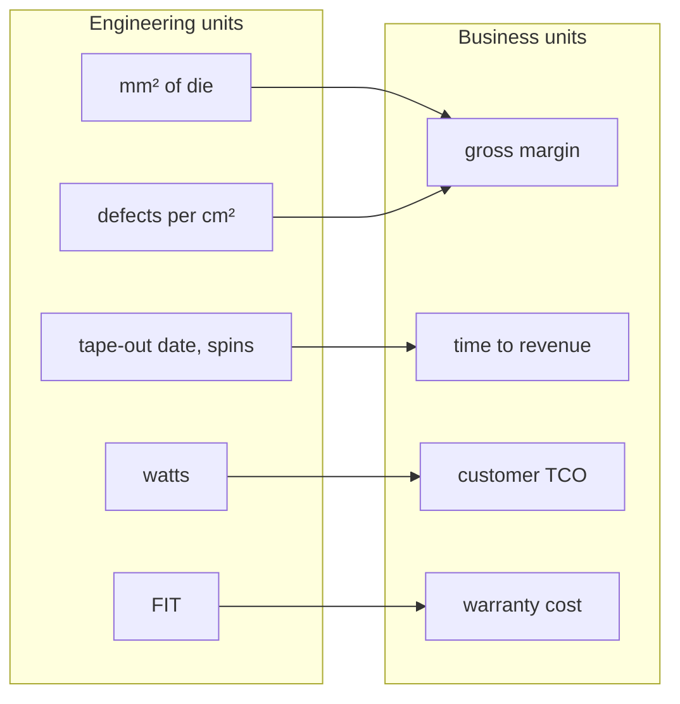

<!-- status: reviewed -->
# 28-09 · The Business ↔ Engineering Translation Table

| | |
|---|---|
| **Course** | [28 · Technical Diligence and Engineering Leadership Fluency](../README.md) |
| **University equivalent** | No direct university equivalent. It joins the cost models of semiconductor manufacturing (die cost and yield, as in a VLSI or fabrication course), engineering economics, and the managerial-accounting view of margins into one table that converts in both directions |
| **Prerequisites** | [25-04](../../25-fabrication-packaging-test-and-reliability/chapters/25-04-yield-and-die-cost.md) (dies per wafer and yield), [26-03](../../26-engineering-design-and-professional-practice/chapters/26-03-engineering-economics-1.md) and [26-04](../../26-engineering-design-and-professional-practice/chapters/26-04-engineering-economics-2.md) (engineering economics), [25-09](../../25-fabrication-packaging-test-and-reliability/chapters/25-09-reliability-physics.md) (FIT), [27-07](../../27-system-architectures/chapters/27-07-ai-datacenter-server-and-rack.md) (datacenter power), [28-08](28-08-integration-risk.md) (delay cost) |
| **Estimated study hours** | 4 |
| **Last verified** | 2026-11-26 |

**Learning objectives.** After this chapter you can:

1. Translate gross margin into die area, defect density, wafer price and package cost, and compute the elasticity of die cost to die area.
2. Reverse the translation: turn a margin target into a maximum die cost and die area.
3. Put a price on schedule (a delay and a respin) and on power (a customer's energy cost over a product's life).
4. Turn a reliability figure (FIT) into expected field failures and their cost.
5. Rank engineering knobs by their effect on margin with a sensitivity (tornado) analysis.

---

## 1. Big picture

A corporate development manager and a chief architect often describe the same product in different units. One speaks of gross margin, time to revenue and total cost of ownership; the other of square millimetres, tape-out dates, watts and failures in time. Most misunderstandings in diligence and in integration come from failing to convert between them. This chapter collects the conversions into one table and works the important ones in both directions: from an engineering choice to its financial effect, and from a financial target to the engineering specification it implies. The physics and the formulas come from earlier courses; what is new is putting them side by side so that a question in one language can be answered in the other.

- **Why it exists:** engineering leaders answer in engineering units; investment committees decide in financial ones. The translator who can move between them asks better questions and catches inconsistent claims.
- **Where it shows up:** pricing and margin reviews, deal models, product-definition meetings, customer total-cost-of-ownership discussions, and integration planning.
- **What it produces:** a one-page table of conversions, the sensitivities that matter most, and the habit of checking that a business plan's numbers are physically possible.
- **The rule of thumb:** every business number about a chip has an engineering driver, and the driver usually enters non-linearly.

## 2. Intuition first

**A currency table.** A traveler with a currency table can price anything in either currency. The translation table works the same way, with one difference that matters: the exchange rates are not constant. A 10% larger die costs more than 10% more, because fewer dies fit on the wafer and each is more likely to catch a defect. A one-month delay costs more near the end of a market window than at its start. A watt saved in a datacenter is worth more where electricity is expensive. The table therefore gives formulas and sensitivities, not fixed rates.

Where the analogy breaks down: currencies are fungible; engineering quantities trade off against each other. Shrinking a die to save cost can raise power density or cost performance; adding a feature to raise price adds area. The table converts one quantity at a time, and the engineering tradeoff tables of every chapter say what each conversion costs elsewhere.

## 3. Theory

### 3.1 The translation table

| Business quantity | Engineering drivers | Translation | Taught in |
|---|---|---|---|
| Unit cost, gross margin | Die area $A$, defect density $D_0$, wafer price $W$, package and test cost, average selling price (ASP) | $C_{\text{die}} = W/(\text{DPW}\cdot Y)$; $\text{GM} = 1 - (C_{\text{die}} + C_{\text{pkg+test}})/\text{ASP}$ | 25-04, 25-11 |
| R&D and NRE (non-recurring engineering: the one-time cost of designing and taping out) | Team size and duration, EDA and IP licenses, mask sets | Engineer-months × loaded cost + licenses + masks | 26-03, 26-06 |
| Time to revenue | Tape-out date, spins, qualification | Delay cost $\approx R\,d_m/12$ for $d_m$ months in a fixed window; respin = masks + delay | 26-05, 28-03, 28-08 |
| Customer total cost of ownership | Power, PUE, electricity price, lifetime, performance | Energy cost $= P \cdot \text{PUE} \cdot h \cdot p_e$ | 22-10, 27-07 |
| Warranty and field cost | Failure rate (FIT), installed base, hours | Failures $= \lambda N t$; cost = failures × cost each | 25-09, 28-03 |
| Price premium | Performance, performance per watt, features | Customer value (TCO and revenue) at the buyer's operating point | 28-02, 28-04 |
| Risk-adjusted value | Milestone probabilities, maturity level | $V\prod_k p_k/(1 + r)^{T/12}$: value $V$ times the milestone probabilities $p_k$, discounted over $T$ months | 28-01, 28-03 |
| Revenue forecast | Design wins, conversion, lag | Funnel value (28-06 §3.5) | 28-06 |

Each row runs both ways. The forward direction answers "what does this engineering choice cost or earn?"; the reverse answers "what must the engineering deliver to hit this business target?".

### 3.2 Unit cost and the elasticity of die area

From 25-04, the dies per wafer of diameter $d$ for die area $A$ is approximately

$$
\text{DPW} \approx \frac{\pi d^2}{4A} - \frac{\pi d}{\sqrt{2A}}
$$

and the Poisson yield is $Y = e^{-AD_0}$. The cost per good die is $C_{\text{die}} = W/(\text{DPW}\cdot Y)$. Ignoring the edge term, $\text{DPW} \propto 1/A$ and

$$
C_{\text{die}} \propto A\,e^{AD_0} \quad\Rightarrow\quad \varepsilon = \frac{d\ln C_{\text{die}}}{d\ln A} = 1 + AD_0
$$

The **elasticity** $\varepsilon$ is the percentage change in die cost per percentage change in area. It exceeds 1 because a larger die both occupies more wafer and is more likely to catch a defect; the edge term adds a little more, since large dies waste more of the wafer's rim. For a 100 mm² die at $D_0 = 0.1$ per cm² ($AD_0 = 0.1$), $\varepsilon \approx 1.1$ before the edge term (Example 28-09.1). For a 600 mm² die at the same defect density, $\varepsilon \approx 1.6$: big dies are where area discipline pays most.

> **Going deeper — the edge term and clustering.** Write $\text{DPW}(A) = \pi d^2/(4A) - \pi d/\sqrt{2A}$ and $C = W/[\text{DPW}(A)\,e^{-AD_0}]$. Then $\ln C = \ln W - \ln \text{DPW} + AD_0$, and $\varepsilon = d\ln C/d\ln A = 1 + AD_0 + \big[\pi d/(2\sqrt{2A})\big]/\text{DPW}$: the edge loss shrinks more slowly than the usable area, which adds the last term. On a 300 mm wafer it is about 0.05 at 100 mm² and 0.15 at 600 mm² (so $\varepsilon \approx 1.15$ and 1.75). The Poisson yield used here is the pessimistic case: with the clustered (negative binomial) yield of 25-04, $Y = (1 + AD_0/\alpha)^{-\alpha}$, the defect term becomes $AD_0/(1 + AD_0/\alpha)$, which at 600 mm² and $\alpha = 2$ gives an elasticity of about 1.46 before the edge term rather than 1.6.

> **Math refresher — elasticity.** For $y = f(x)$, the elasticity $d\ln y/d\ln x = (x/y)\,dy/dx$ is the ratio of percentage changes. For a product $y = g(x)h(x)$ it is the sum of the elasticities of $g$ and $h$: here $A$ (elasticity 1) and $e^{AD_0}$ (elasticity $AD_0$).

**Wafer prices.** Leading-edge wafers are expensive and rising: reports put TSMC's N3 wafers around \$18,500 (IBS: about \$20,000) and N2 above \$30,000 (reported October 2024 and December 2023) [R-575] **[Industry estimate: no published price lists; two to three years old]**. At those prices, a few square millimetres matter.

### 3.3 Reversing the translation: from a margin target to a die

A product manager sets a selling price and a gross-margin target. The total unit cost allowed is $\text{ASP}(1 - \text{GM}_{\text{target}})$; subtracting package and test leaves the maximum die cost; inverting the cost model gives the maximum die area (Example 28-09.2). This is how a business plan becomes an area budget for the architects, and how a diligence analyst checks whether a target's margin plan is compatible with its die size.

### 3.4 Time and power are money

**Schedule.** In a market window that ends at a fixed date, a delay of $d_m$ months at revenue rate $R$ per year loses about $R\,d_m/12$ of revenue (the subscript keeps it apart from the wafer diameter $d$) (28-08 §3.2); the gross profit lost is that times the gross margin. A respin adds a new mask set (at the leading edge, estimates range from about \$10–20M to about \$40M [R-321], [R-623] **[Industry estimate; Contested]**) and a delay of several months, so its cost is usually dominated by the delay, not the masks (Example 28-09.3).

**Power, for the customer.** A datacenter pays for every watt in the server and again, in part, for the cooling and power distribution that serve it. The power usage effectiveness (PUE, the ratio of facility power to IT power) captures the overhead: at a PUE of 1.3, each watt of IT load brings 0.3 W of overhead with it. Over a life of $h$ hours at electricity price $p_e$, a device drawing $P$ costs

$$
E_{\text{cost}} = P \cdot \text{PUE} \cdot h \cdot p_e
$$

in electricity. At kilowatt power and multi-year lives, energy is a meaningful fraction of a device's price, which is why performance per watt carries a price premium (Example 28-09.4). Datacenter electricity use is large and growing: US datacenters used about 4.7% of US electricity in 2024 (LBNL) **[Established]**, and global datacenter use was about 415 TWh in 2024 (IEA) [R-452] **[Industry estimate]**.

### 3.5 Reliability is money

A failure rate $\lambda$ in FIT (failures per $10^9$ device-hours, 25-09) across an installed base of $N$ devices over $t$ hours produces about $\lambda N t \times 10^{-9}$ failures, each with a cost for replacement, logistics and the customer's downtime. Qualification bounds from 28-03 become a warranty-reserve estimate this way (Example 28-09.5). In automotive and datacenter markets the cost per failure includes reputational and contractual penalties that can dwarf the part's price.

### 3.6 Sensitivity analysis

With many drivers, a **tornado analysis** varies each by the same fraction (say ±10%) with the others fixed, and ranks the effects on the output. For gross margin, the typical ranking is selling price and die area first, wafer price next, and package cost and defect density last for small dies; for large dies defect density rises up the list because it enters through $e^{AD_0}$ (Example 28-09.6). Equal swings are only a first pass, because the drivers are not equally uncertain. A better tornado swings each driver across its *plausible* range (the low and high cases a skeptical engineer would accept). Die area after tape-out is known within a few percent; defect density on an immature node can be off by two or three times. At 100 mm², moving $D_0$ from 0.1 to 0.3 per cm² costs **7.9** points of margin, against 4.1 for a 10% area error and **2.1** for a 5% one, so for an early-node die defect density tops the plausible-range tornado even though it sits near the bottom of the equal-swing one. The ranking tells a diligence team which engineering claims to test hardest.

## 4. Worked examples

Wafer prices are from [R-575]; other parameters are illustrative assumptions. Dies per wafer use the formula of §3.2 for a 300 mm wafer, rounded down to whole dies unless stated.

### Example 28-09.1 · What 20% more area costs (tier B)

**Setup.** A die on an \$18,500 N3 wafer [R-575] grows from 100 mm² to 120 mm²; $D_0$ = 0.1 per cm² (0.001 per mm², assumed). Find the dies per wafer, yield and cost per good die for each, the percentage cost increase, and the implied average elasticity.

**Solution.**

- 100 mm²: DPW $= \pi \cdot 300^2/(4 \times 100) - \pi \cdot 300/\sqrt{2 \times 100} = 706.9 - 66.6 = 640.2$, so **640** whole dies; yield $e^{-0.1}$ = **90.5**%; cost $18500/(640 \times 0.905)$ = **31.95** \$ per good die.
- 120 mm²: DPW $= 589.0 - 60.8 = 528.2$, so **528**; yield $e^{-0.12}$ = **88.7**%; cost **39.51** \$.
- Increase **23.7**%; average elasticity $23.7/20$ = **1.18**.

**Units check.** mm² × per mm² = dimensionless exponent; $/wafer ÷ good dies per wafer = $/die. ✓

**Sanity check.** The average elasticity of 1.18 sits above $1 + AD_0 = 1.1$ for three reasons: $AD_0$ itself rises across the interval (to 1.12 at 120 mm²), the wafer-edge term adds about 0.05 at these sizes, and a ratio of simple percentages differs from a logarithmic (point) elasticity. A feature that adds 20% area must earn about 24% more die cost back in price or volume.

### Example 28-09.2 · From a margin target to an area budget (tier B)

**Setup.** A product will sell at $60 with $8 of package and test cost, and must reach 60% gross margin. Find the maximum unit cost, the maximum die cost, and the largest die area that meets it on the same wafer and defect density (dies per wafer unrounded).

**Solution.** Unit cost $60 \times 0.40$ = **24** \$; die cost $24 - 8$ = **16** \$. The die cost $18500/(\text{DPW}(A)e^{-0.001A})$ rises with $A$, so bisect on $A$ until it equals \$16: at 40 mm² it is **11.59** \$ (too cheap, so the die can grow), at 55 mm² **16.35** \$ (too dear), at 50 mm² **14.74** \$, at 54 mm² **16.03** \$, and at 53.9 mm² \$16.00, so $A$ = **53.9** mm².

**Units check.** $ − $ = $; area in mm². ✓

**Sanity check.** At N3 prices a $60 part with a 60% margin allows only about 54 mm² of silicon. A target proposing a 100 mm² die at this price is proposing a 33% margin (Example 28-09.6's base case at $90 gives 55.6%), so either the price, the node or the margin plan is wrong.

### Example 28-09.3 · The cost of a respin (tier B)

**Setup.** A product earning $300M a year at 60% gross margin, in a fixed market window, needs a full-layer respin: a new mask set at about \$40M (the top of the \$10–40M range of estimates [R-321], [R-623]) and a 4-month delay. Find the lost revenue, the lost gross profit, and the total profit impact.

**Solution.** Lost revenue $300 \times 4/12$ = **100** \$M; lost gross profit $100 \times 0.6$ = **60** \$M; with masks, **100** \$M.

**Units check.** $M/year × years = $M. ✓

**Sanity check.** The delay costs half again as much as the masks, and the mask figure used is the top of the range of estimates: at \$10–20M masks the delay dominates even more. Respin risk (28-06's base rates) is therefore mainly schedule risk, which is why verification effort (28-07) is worth paying for.

### Example 28-09.4 · What a watt is worth to a datacenter (tier B)

**Setup.** An accelerator draws 1,000 W; a competitor delivers the same performance at 900 W. With PUE 1.3, electricity at $0.08 per kWh and a 4-year life (8,766 hours a year), all assumed, find the lifetime energy and its cost for the first, the cost for the second, the saving per device, and the saving for 10,000 devices.

**Solution.** Energy $1.0 \times 1.3 \times 35064$ = **45583** kWh, costing **3647** \$; the 900 W device **3282** \$; saving **365** \$ per device; **3.65** \$M for 10,000.

**Units check.** kW × h = kWh; kWh × $/kWh = $. ✓

**Sanity check.** A 10% power advantage is worth a few hundred dollars per device over its life at these prices, more where power is expensive or capacity is limited by the power the site can draw. In power-constrained datacenters the more important translation is capacity: 10% less power per device fits about 11% more devices in the same power budget.

### Example 28-09.5 · From FIT to field failures (tier A)

**Setup.** A part rated at 100 FIT is installed in 1 million systems running continuously. Find the expected failures in a year and their cost at $500 each, and the same at 500 FIT.

**Solution.** $100 \times 10^{-9} \times 10^6 \times 8766$ = **877** failures, **0.438** \$M. At 500 FIT: **4383** failures, **2.19** \$M.

**Units check.** failures/(device·hour) × devices × hours = failures. ✓

**Sanity check.** The cost scales linearly with FIT, so the qualification bound of 28-03 is directly a warranty-reserve input. A FIT claim without its confidence level and conditions (28-03 §3.3) cannot be reserved against.

### Example 28-09.6 · Which knob moves margin most? (tier C)

**Setup.** Base case: ASP \$90, die 100 mm² on an \$18,500 wafer with $D_0$ = 0.001 per mm², package and test \$8. Find the base gross margin and the change in margin (percentage points) when each of ASP, die area, wafer price, defect density and package cost rises by 10% with the others fixed.

**Solution.** Base: die $31.95, unit cost $39.95, margin **55.6**%. Changes: ASP **+4.0** points; die area **−4.1**; wafer price **−3.5**; defect density **−0.36**; package cost **−0.89**.

**Units check.** Margin is a fraction; changes in percentage points. ✓

**Sanity check.** Die area and price dominate; for this small die, defect density barely matters. For a 600 mm² die the defect-density bar would grow several-fold, because it enters as $e^{AD_0}$. The ranking tells the analyst where the target's assumptions deserve the most scrutiny.

<!-- answer-key -->

| ID | Quantity | Value | Unit |
|---|---|---|---|
| Txt 28-09.1 | elasticity 1 + AD0 at 100 mm² | 1.1 | — |
| Txt 28-09.2 | elasticity 1 + AD0 at 600 mm² | 1.6 | — |
| Txt 28-09.3 | margin change, D0 from 0.1 to 0.3 per cm², 100 mm² | 7.9 | points |
| Txt 28-09.4 | margin change, 5% more area, 100 mm² | 2.1 | points |
| Txt 28-09.5 | point elasticity with edge term, 100 mm² | 1.15 | — |
| Txt 28-09.6 | point elasticity with edge term, 600 mm² | 1.75 | — |
| Txt 28-09.7 | clustered-yield elasticity before edge, 600 mm², alpha 2 | 1.46 | — |
| Ex 28-09.1a | dies per wafer, 100 mm² | 640 | dies |
| Ex 28-09.1f | dies per wafer before rounding, 100 mm² | 640.2 | dies |
| Ex 28-09.1g | dies per wafer before rounding, 120 mm² | 528.2 | dies |
| Ex 28-09.1a1 | yield, 100 mm² | 90.5 | % |
| Ex 28-09.1a2 | cost per good die, 100 mm² | 31.95 | $ |
| Ex 28-09.1b | dies per wafer, 120 mm² | 528 | dies |
| Ex 28-09.1b1 | yield, 120 mm² | 88.7 | % |
| Ex 28-09.1b2 | cost per good die, 120 mm² | 39.51 | $ |
| Ex 28-09.1c | cost increase | 23.7 | % |
| Ex 28-09.1c1 | average elasticity | 1.18 | — |
| Ex 28-09.2a | maximum unit cost | 24 | $ |
| Ex 28-09.2b | maximum die cost | 16 | $ |
| Ex 28-09.2c | maximum die area | 53.9 | mm² |
| Ex 28-09.2c1 | die cost at 40 mm² | 11.59 | $ |
| Ex 28-09.2c2 | die cost at 55 mm² | 16.35 | $ |
| Ex 28-09.2c3 | die cost at 50 mm² | 14.74 | $ |
| Ex 28-09.2c4 | die cost at 54 mm² | 16.03 | $ |
| Ex 28-09.2d | margin of a 100 mm² die at $60 | 33 | % |
| Ex 28-09.3a | lost revenue | 100 | $M |
| Ex 28-09.3b | lost gross profit | 60 | $M |
| Ex 28-09.3c | total profit impact | 100 | $M |
| Ex 28-09.4a | lifetime energy | 45583 | kWh |
| Ex 28-09.4b | energy cost, 1,000 W | 3647 | $ |
| Ex 28-09.4c | energy cost, 900 W | 3282 | $ |
| Ex 28-09.4d | saving per device | 365 | $ |
| Ex 28-09.4e | saving for 10,000 | 3.65 | $M |
| Ex 28-09.4f | more devices in the same power | 11 | % |
| Ex 28-09.5a | failures, 100 FIT | 877 | failures |
| Ex 28-09.5b | cost, 100 FIT | 0.438 | $M |
| Ex 28-09.5c | failures, 500 FIT | 4383 | failures |
| Ex 28-09.5d | cost, 500 FIT | 2.19 | $M |
| Ex 28-09.6a | base gross margin | 55.6 | % |
| Ex 28-09.6b | ASP +10% | 4.0 | points |
| Ex 28-09.6c | die area +10% | −4.1 | points |
| Ex 28-09.6d | wafer price +10% | −3.5 | points |
| Ex 28-09.6e | defect density +10% | −0.36 | points |
| Ex 28-09.6f | package cost +10% | −0.89 | points |

## 5. Simulate it

The lab is [labs/28-09-lab/](../labs/28-09-lab/README.md). `translate.py` implements the conversions: dies per wafer, yield, die cost and elasticity, the reverse area budget, delay and respin cost, lifetime energy cost, field failures and a margin tornado.

1. *Predict* the elasticity of die cost to area for a 600 mm² die at 0.1 defects per cm² (with the edge term). Then plot cost per good die and elasticity against area from 20 to 800 mm².
2. *Predict* the maximum die area for Example 28-09.2's product on a $30,000 N2 wafer [R-575]. Then plot the area budget against the margin target for N3 and N2 wafer prices.
3. *Predict* the lifetime energy cost of a 1,000 W device at $0.15 per kWh. Then plot energy cost against power for three electricity prices.
4. *Predict* how the tornado of Example 28-09.6 changes for a 600 mm² die at ASP $900. Then draw both tornados.

*Figure 1. Two translations: die area to unit cost (§3.2), and engineering knobs to gross margin (§3.6).*

## 6. Engineering tradeoffs

| Knob | Improves | Costs | Typical decision owner |
|---|---|---|---|
| Smaller die (fewer features, denser layout) | Unit cost, margin | Performance or features; power density; design time | Product definition with architects |
| Mature node instead of leading edge | Wafer price, mask cost | Performance per watt, density | Product line management |
| Lower power at equal performance | Customer TCO, price premium | Design effort, area for power management | Architects with marketing |
| More verification and margin | Fewer respins, lower FIT | NRE, schedule up front | VP of Engineering |
| Longer qualification | Lower field cost, credible FIT | Time to revenue | Quality with business unit |
| Higher selling price | Margin | Volume, competitive position | Business unit |

## 7. Numbers to know

Figures are as of Nov 2026 unless dated otherwise.

| Quantity | Value | Note |
|---|---|---|
| N3 and N2 wafer prices | about \$18,500 (IBS: about \$20,000) and above \$30,000 per 300 mm wafer (reported 2023–2024) | Reports, not price lists [R-575] **[Industry estimate]** |
| Leading-edge mask set | about \$10–20M (2026 estimate) to about \$40M (2022 estimate) at 3–5 nm | [R-321], [R-623] **[Industry estimate; Contested]** |
| Die-cost elasticity to area | about $1 + AD_0$, plus an edge term | §3.2 |
| Gross margin | $1 - (C_{\text{die}} + C_{\text{pkg+test}})/\text{ASP}$ | §3.1 |
| Lifetime energy cost | $P \cdot \text{PUE} \cdot h \cdot p_e$ | §3.4 |
| Field failures | $\lambda N t \times 10^{-9}$ (λ in FIT) | §3.5 |
| US datacenter electricity, 2024 | about 192 TWh, 4.7% of US use | LBNL [R-452] **[Established]** |

## 8. Common mistakes

- **Treating die cost as proportional to area.** It grows faster, by the elasticity $1 + AD_0$ plus edge losses.
- **Quoting margin without the cost stack.** Die, package, test and yield loss after packaging all matter.
- **Counting a respin as its mask cost.** The delay usually costs more.
- **Ignoring the customer's power bill.** Performance per watt is a price argument only when translated into TCO or capacity.
- **Reserving warranty on a typical FIT.** Use a bound with its confidence and conditions.
- **Testing every assumption equally, or ranking them by equal swings.** Rank them by sensitivity across their plausible ranges and test the ones that move the answer: an uncertain small-looking driver can matter more than a well-known large one.

## 9. Practitioner lens

**State of play (as of Nov 2026).**

- **Wafer prices keep rising at the leading edge.** Reports put N2 wafers above $30,000 against about $18,500 for N3 [R-575] **[Industry estimate]**, so area discipline and chiplet partitioning (25-07) are margin decisions as much as engineering ones.
- **Mask sets are a large fixed cost.** Estimates range from about \$10–20M to about \$40M at 3–5 nm [R-321], [R-623] **[Industry estimate; Contested]**, which raises the break-even volume for leading-edge designs and the cost of each respin.
- **Power is a capacity constraint as much as a cost.** US datacenters used about 4.7% of US electricity in 2024, with projections of 9.5–15.3% by 2030 [R-452] **[Industry estimate for projections]**; in power-limited sites, watts per unit of work decide how much can be deployed.

**Commercial relevance.** The translation table is the bridge between the technical chapters of this curriculum and the financial models of a deal. It lets the analyst check a target's plan for internal consistency (does the die size fit the margin?), value engineering claims in money (what is 10% less power worth to the customer?), and decide where to spend diligence effort (which assumptions move value most?).

**Marketing vs Reality.**

- *"Industry-leading gross margin on our next product."* Ask for the die area, node, expected yield, package cost and price, and compute it.
- *"Only a small die-size increase."* Translate it with the elasticity: 10% more area is about 12% more die cost at modest die sizes, more for large dies.
- *"Our efficiency saves customers millions."* Ask for the power, PUE, electricity price and fleet size behind the figure.
- *"Rated at X FIT."* Ask for the confidence level and conditions, then compute the expected failures in the customer's fleet.

**Questions for engineering leaders.**

1. *"What gross margin does your product plan assume, and what die area and yield does that imply?"* Strong: a cost stack that reconciles. Evasive: "Margins will be healthy."
2. *"What would one respin cost you, in masks and in months?"* Strong: both numbers and the revenue at stake. Evasive: "We don't plan for respins."
3. *"How do you translate your power advantage into customer value?"* Strong: a TCO model with stated assumptions. Evasive: "Customers love efficiency."
4. *"Which assumption in your plan, if wrong by 10%, would hurt margin most?"* Strong: a ranked sensitivity. Evasive: "We've been conservative everywhere."

## 10. Concept check

1. Why does die cost grow faster than die area?

   

Answer

   Fewer dies fit on the wafer (cost ∝ $A$) and each is more likely to contain a defect (yield $e^{-AD_0}$), so cost ∝ $Ae^{AD_0}$ with elasticity $1 + AD_0$, plus edge losses.

   

2. How do you turn a margin target into an area budget?

   

Answer

   Allowed unit cost = ASP × (1 − target margin); subtract package and test to get the die-cost budget; invert the die-cost model to find the largest area that meets it.

   

3. What dominates the cost of a respin?

   

Answer

   Usually the delay: lost revenue and gross profit in the market window, which in Example 28-09.3 exceed the mask cost.

   

4. How do you value a power advantage for a datacenter customer?

   

Answer

   Energy cost $P \cdot \text{PUE} \cdot h \cdot p_e$ over the life, or, where power capacity is the limit, the extra devices the saved power allows.

   

5. How does FIT become money?

   

Answer

   Expected failures $\lambda N t \times 10^{-9}$ times the cost per failure gives the expected field cost, the basis of a warranty reserve.

   

6. Why do a tornado analysis?

   

Answer

   To rank which assumptions move the answer most, so diligence tests those first.

   

Problems: [28-09 problem set](../problems/28-09-problems.md) · Solutions: [28-09 solutions](../solutions/28-09-solutions.md)

## 11. Key terms

[Gross margin](../../../reference/glossary.md#gross-margin) · [Dies per wafer](../../../reference/glossary.md#dies-per-wafer) · [Cost elasticity of die area](../../../reference/glossary.md#cost-elasticity-of-die-area) · [Area budget](../../../reference/glossary.md#area-budget) · [Power usage effectiveness (PUE)](../../../reference/glossary.md#power-usage-effectiveness-pue) · [Total cost of ownership (TCO)](../../../reference/glossary.md#total-cost-of-ownership-tco) · [Sensitivity (tornado) analysis](../../../reference/glossary.md#sensitivity-tornado-analysis)

## 12. Connections

- **Previous:** [28-08 Post-Acquisition Integration Risk](28-08-integration-risk.md).
- **Next:** [28-10 Conversation Scenarios](28-10-conversation-scenarios.md), where the translations are used live in dialogue.
- **Prerequisites used here:** die cost and yield ([25-04](../../25-fabrication-packaging-test-and-reliability/chapters/25-04-yield-and-die-cost.md)); engineering economics ([26-03](../../26-engineering-design-and-professional-practice/chapters/26-03-engineering-economics-1.md), [26-04](../../26-engineering-design-and-professional-practice/chapters/26-04-engineering-economics-2.md)); FIT ([25-09](../../25-fabrication-packaging-test-and-reliability/chapters/25-09-reliability-physics.md)); datacenter power ([27-07](../../27-system-architectures/chapters/27-07-ai-datacenter-server-and-rack.md)); delay cost ([28-08](28-08-integration-risk.md)).
- **Used later:** the dialogues of [28-10](28-10-conversation-scenarios.md) and the capstones.

> **Deeper:** see companion repo *Semiconductor Capital Equipment* for how wafer cost is built up from tools and fab capital.

## 13. Further study

- J. L. Hennessy and D. A. Patterson, *Computer Architecture: A Quantitative Approach*: the section on the cost of an integrated circuit.
- R. A. Brealey, S. C. Myers and F. Allen, *Principles of Corporate Finance*: the chapters on project analysis and sensitivity analysis.
- LBNL's United States Data Center Energy Usage Report (public) [R-452].
- Lecture videos: MIT OpenCourseWare 15.401 *Finance Theory I* (recorded and public), lectures on capital budgeting.

## 14. Sources

1. Wafer prices [R-575]; mask-set costs [R-321], [R-623].
2. Datacenter electricity [R-452].
