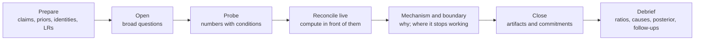

<!-- status: reviewed -->
# 28-10 · Conversation Scenarios

| | |
|---|---|
| **Course** | [28 · Technical Diligence and Engineering Leadership Fluency](../README.md) |
| **University equivalent** | No direct university equivalent. It is the practicum of this course: the case method of business schools and the deposition practice of law schools, applied to technical conversations with semiconductor engineering leaders, with every live calculation drawn from this curriculum |
| **Prerequisites** | [28-01](28-01-technology-evaluation-framework.md) to [28-09](28-09-business-engineering-translation.md) |
| **Estimated study hours** | 15 |
| **Last verified** | 2026-11-26 |

**Learning objectives.** After this chapter you can:

1. Prepare for a technical conversation: write the claims, priors, identities and likelihood ratios before the meeting.
2. Use the core conversational moves (ask for the number with conditions, reconcile live, follow the mechanism, probe the boundary, ask for artifacts, test candor, close with commitments) and recognize the anti-patterns.
3. Perform the live calculations of Courses 14–28 fast enough to use them in a meeting, and say what the result means.
4. Debrief a conversation: score answers as evidence, group them by cause, update the claim's probability and list follow-ups.
5. Calibrate your own judgments over time with a scoring rule.

---

## 1. Big picture

Everything in this curriculum is meant to come together in a room: a corporate development manager across the table from a VP of Engineering or a chief architect, with an hour to learn what the deck does not say. This chapter is the practicum. It sets out how a good technical conversation is structured, then works through 26 scenarios across the domains of Courses 14–28: accelerators, CPUs, memory, interconnect, optics, analog, RF, power, packaging, embedded systems, teams, integration and economics. Each scenario gives the context, a condensed dialogue, the live calculation the analyst does, and an annotated debrief that scores the answers as evidence. The aim is fluency: hearing a claim, knowing which identity governs it, computing the check in a minute, and asking the question that the result suggests.

- **Why it exists:** knowing the material is necessary but not sufficient; using it in real time, politely and precisely, is a separate skill that improves with deliberate practice.
- **Where it shows up:** management presentations, expert calls, customer reference calls, integration planning sessions, and board or investment-committee discussions with engineering leaders present.
- **What it produces:** a repeatable conversation method, a pocket set of live checks, and a debrief format that turns impressions into evidence.
- **The rule of thumb:** prepare the arithmetic, ask for numbers with conditions, compute in front of them, and write the ratios down before you leave the building.

## 2. Intuition first

**A deposition, not a cross-examination.** A lawyer taking a deposition wants facts on the record, not a win: open questions first, then specific ones that pin down who, what, when and how much, with documents to anchor the answers. A technical diligence conversation works the same way. The analyst is collecting evidence about claims, so the questions start broad ("walk me through the architecture"), narrow to numbers with conditions ("at what batch and latency?"), and end with artifacts ("can we see the measurement?").

Where the analogy breaks down: the engineers across the table are not opposing witnesses. Many will be colleagues after the deal, and their goodwill is part of what is being acquired. A conversation that feels like an interrogation loses information, because people stop volunteering limits and caveats. The best technical conversations feel like two engineers working a problem together, with the analyst doing just enough arithmetic to show that the numbers will be checked.

**Preparation decides the outcome.** Most of the value of a meeting is created before it starts: the identities chosen, the checks computed, the likelihood ratios written down. An analyst who has computed a roofline before the meeting hears "40% utilization at batch 8" and knows within seconds that it does not fit; one who has not hears a plausible number.

## 3. Theory

### 3.1 A conversation as a sequence of tests

28-01 and 28-04 treat each answer as evidence with a likelihood ratio. A conversation is a sequence of such tests, chosen and ordered by the analyst:

1. **Prepare.** For each claim that matters to the deal, write the claim, a prior probability, the governing identity and its pre-computed check, two or three **diagnostic questions** (questions whose strong and weak answers differ in a way you can check; 28-04), and the strong, partial and evasive answers you expect, each with a likelihood ratio (for example 3, 1 and 0.4).
2. **Conduct.** Ask, listen, reconcile, and take notes in the ratio language as you go.
3. **Debrief.** Within hours, group the answers by underlying fact (28-06 §3.6), multiply the ratios, compute the posterior, and list follow-ups with owners and dates. The written result is the **debrief ratio sheet**: one line per answer with its ratio, grouped by fact, then the posterior for each claim and the follow-ups.

The debrief arithmetic is the odds form of Bayes' rule: posterior odds = prior odds × the product of the likelihood ratios of the conditionally independent answers.

### 3.2 The core moves

- **Ask for the number with its conditions.** "What utilization?" invites an adjective; "what utilization on a 70B model at FP8, batch 16, 50 ms per token?" invites a number that can be checked.
- **Reconcile live.** Compute the check in front of the speaker, out loud and briefly: "So that's 16 FLOP per byte against a ridge of 500; I get about 3% of peak. Help me square that with 40%." This signals that numbers will be checked and invites the explanation that resolves the gap, or exposes it.
- **Follow the mechanism.** Ask why a number is what it is. Strong teams explain mechanisms in a sentence; weak ones repeat the number.
- **Probe the boundary.** Ask where the claim stops being true: at what batch, temperature, load, back-off or volume. Honest limits are strong evidence.
- **Ask for artifacts.** Measurement data, bug trackers, stepping histories, license terms, test reports. An artifact turns a partial answer into a strong one.
- **Test candor.** Ask what the speaker would least like you to check, or what they would do differently. The reaction is information.
- **Close with commitments.** End with specific follow-ups: what will be sent, by whom, by when. Whether they arrive is evidence too.

### 3.3 Anti-patterns

- **Leading questions** ("I assume the utilization is above 30%?") hand the answer to the speaker.
- **Anchoring the speaker with your number first.** Ask for theirs, then reconcile.
- **Arguing.** Disagreement belongs in the debrief; in the room, ask for the explanation.
- **Bluffing.** If a term is unfamiliar, ask; pretending loses more than it saves.
- **Counting repeats.** Two answers about one fact are one piece of evidence.
- **Mistaking fluency for truth.** Polished delivery has a likelihood ratio near 1 unless the content can be checked.

### 3.4 Calibrating yourself

Judgments improve when they are scored. After each deal, record the probabilities you assigned to key claims and whether the claims turned out true. The **Brier score**, $\frac{1}{n}\sum_i (p_i - o_i)^2$ with $o_i \in \{0, 1\}$, is 0 for perfect forecasts and 0.25 for always saying 50%; it rewards both accuracy and honest confidence. It is a *proper* scoring rule: if a claim is true with probability $q$ and you report $p$, the expected score is

$$
E\big[(p - o)^2\big] = q(1 - p)^2 + (1 - q)p^2 = (p - q)^2 + q(1 - q),
$$

which is smallest at $p = q$, so shading a forecast up or down can only hurt (Problem 28-10.12). A single Brier number does not say *which way* you are miscalibrated, though. For that, keep a calibration table: group past claims by the probability you gave them (say 0.5–0.6, 0.6–0.7, …) and compare each group's average forecast with the fraction that came true. Groups whose outcomes fall short of the forecasts mean your ratios are too generous; outcomes above the forecasts mean they are too harsh. Over a few dozen claims, the next conversation's priors and ratios can be adjusted accordingly (Problem 28-10.10).

### 3.5 The pocket card

The live checks used most often, with the chapter that derives each:

| Claim type | Live check | Chapter |
|---|---|---|
| Accelerator throughput | Ridge $F/B_{\text{mem}}$; decode intensity $2N_b/b_w$ ($N_b$ sequences, $b_w$ bytes per weight); attainable = intensity × bandwidth | 28-04 |
| Iso-power CPU gain | Reduction $1 - 1/[g_C(R/g_{\text{IPC}})^3]$ | 28-04 |
| Memory and link power | Bits per second × pJ/bit | 28-04 |
| Converter quality | $\text{FoM}_S = \text{SNDR} + 10\log_{10}(f_s/2P)$; ceiling about 191.8 dB | 28-05 |
| PA efficiency | Class B $(\pi/4)10^{-\text{BO}/20}$; Doherty twice that below half amplitude | 28-05 |
| Supply heat | $P_{\text{out}}(1/\eta - 1)$ | 28-05 |
| Package yield | Product of die, stack and assembly yields | 28-05 |
| Battery life | Sleep current plus active charge per period | 28-05 |
| Track record | Beta posterior mean $(\alpha_0 + s)/(n_0 + n)$ | 28-07 |
| Schedule | Geometric mean of past overruns × plan | 28-07 |
| People risk | $1 - (1 - q)^{mt}$ | 28-06, 28-07 |
| Customers | $1/\text{HHI}$ | 28-06 |
| Pipeline | Wins × conversion × revenue × average discount factor | 28-06 |
| Delay | Revenue rate × months/12 | 28-08, 28-09 |
| Die cost | Wafer price/(dies per wafer × yield) | 28-09 |
| Customer energy | Power × PUE × hours × price | 28-09 |
| Field failures | FIT × $10^{-9}$ × units × hours | 28-09 |

## 4. Worked examples

Each scenario is a condensed conversation with an invented company; names and parameters are illustrative, not drawn from any real firm. Likelihood ratios are the analyst's assumptions. Sourced facts carry their research-log IDs.

### Example 28-10.1 · The utilization claim (tier B)

**Setup.** A start-up's VP of Engineering (VPE in the dialogues) claims "40% utilization on 70B-parameter decode". Its accelerator: 2 PFLOP/s dense FP8, 4 TB/s of HBM. The analyst's prepared check: the roofline (28-04 §3.2).

**Dialogue.**

- **Analyst:** What utilization do you see on a 70B model in decode, at what batch and latency?
- **VPE:** About 40%, at batch 8, FP8 weights.
- **Analyst:** Let me check that quickly. The ridge is 2 PFLOP/s over 4 TB/s, 500 FLOP per byte. At batch 8 with one-byte weights, decode does 16 FLOP per byte, so the roofline gives 64 TFLOP/s, about 3% of peak. Help me square that with 40%.
- **VPE:** The 40% is prefill. Decode is in the low single digits, as you say; we batch more aggressively in production, around 128.

**Live check.** Ridge $2 \times 10^{15}/4 \times 10^{12}$ = **500** FLOP/byte; decode intensity $2 \times 8/1$ = **16**; attainable $16 \times 4$ TB/s = **64** TFLOP/s, **3.2**% of peak; batch to reach the ridge **250**.

**Debrief.** The first answer attached a prefill number to a decode question. Prefill processes the whole prompt at once, reusing each weight across many tokens, so it is compute-bound; decode generates one token per sequence per step and is bandwidth-bound (28-04 §3.2). Quoting one for the other is the wrong regime, which on the claim "the target reports utilization accurately" is evidence against (LR 0.5). The reconciliation exposed it, and the correction was candid and mechanistic (LR 2), which partly offsets the first answer; on the decode claim itself, the evidence now says low single digits. Follow-up: utilization and latency at batch 128 and the KV-cache capacity that batch requires (the KV cache holds each sequence's attention keys and values, so its size grows with batch and context length).

**Units check.** FLOP/s ÷ byte/s = FLOP/byte; FLOP/byte × byte/s = FLOP/s. ✓

**Sanity check.** The live roofline took a minute and turned a misleading headline into the right question. Without it, 40% would have entered the deal model.

### Example 28-10.2 · "20% faster at the same power" (tier B)

**Setup.** A CPU company's chief architect claims 20% more performance at the same power; IPC rose 10%; capacitance assumed unchanged.

**Dialogue.**

- **Analyst:** How does the 20% split between IPC, frequency and process?
- **Architect:** Ten points of IPC from the wider back end, the rest from frequency; same node, a newer cell library.
- **Analyst:** Then frequency rises about 9%, which costs roughly 30% more power along the voltage–frequency line. Where does the 23% saving in energy per operation come from on the same node?
- **Architect:** Clock gating and the new library give about 12%; the rest is a lower voltage margin from adaptive clocking. I can show the breakdown by block.

**Live check.** Frequency ratio $1.2/1.1$ = **1.091**; power factor $1.091^3$ = **1.298**; required energy-per-operation reduction **23.0**%.

**Debrief.** A decomposition, a mechanism and an offered artifact: strong (LR 3). The remaining risk is the adaptive-clocking margin, which depends on silicon behavior across parts; ask for the distribution (28-05 §3.6). One assumption also needs its own question: a wider back end usually switches more capacitance, so $g_C = 1$ is optimistic. At $g_C = 1.05$ the required reduction rises to $1 - 1/(1.05 \times 1.298)$ = **26.6**%. Ask for the block-level capacitance change along with the breakdown.

**Units check.** Ratios throughout. ✓

**Sanity check.** Without a node change, 23% from design alone is ambitious; the breakdown makes it testable.

### Example 28-10.3 · An HBM pin-rate claim (tier A)

**Setup.** A memory supplier's CTO describes a 2,048-bit HBM stack "shipping at 10 Gb/s". The analyst checks bandwidth and power at an assumed 6 pJ/bit.

**Dialogue.**

- **Analyst:** Is 10 Gb/s the qualified rate at all your customers, or the best bin?
- **CTO:** Qualified at two customers; the third qualifies at 9.2 this quarter.
- **Analyst:** So a stack gives about 2.56 TB/s, and eight stacks about 20 TB/s. At full read rate and an all-in 6 pJ/bit that's over 120 W of memory-subsystem power attributable to each stack, host side included; what energy per bit do you measure at 10 Gb/s, and at which boundary?
- **CTO:** Between 5.5 and 6.5 depending on temperature; I'll send the curve.

**Live check.** Stack bandwidth $2048 \times 10/8$ = **2560** GB/s; eight stacks **20.48** TB/s; memory-subsystem power per stack at an all-in 6 pJ/bit **123** W (an all-in figure including the host side, 28-04 §3.3; the DRAM alone draws less).

**Debrief.** Qualified rates by customer and a measured energy range: strong (LR 3). Follow-up: the curve, and yield at 10 Gb/s.

**Units check.** bits × Gb/s ÷ 8 = GB/s; bits/s × J/bit = W. ✓

**Sanity check.** Memory power at full bandwidth is a large share of an accelerator's budget, so energy per bit at the shipping rate matters as much as the rate.

### Example 28-10.4 · SerDes power, all-in (tier B)

**Setup.** An interconnect start-up claims "2.5 pJ/bit SerDes" for a 51.2 Tb/s switch.

**Dialogue.**

- **Analyst:** Is 2.5 pJ/bit analog only, or including DSP and clocking, and at what channel loss?
- **VP Eng:** Analog front end at 40 dB. All-in with DSP and PLLs it's about 4.
- **Analyst:** So the switch's SerDes draw about 205 W, of which 128 W is the analog part you quote. The headline leaves out more than a third.
- **VP Eng:** That's fair; our datasheet will quote both.

**Live check.** All-in $51.2 \times 10^{12} \times 4 \times 10^{-12}$ = **204.8** W; analog only **128** W; share omitted by the headline **37.5**%.

**Debrief.** Partial initially, strong after reconciliation; the concession to publish both is a candor signal (LR 3 overall for the boundary question).

**Units check.** bits/s × J/bit = W. ✓

**Sanity check.** Comparing a competitor's all-in figure with this analog-only one would have overstated the advantage by 60%.

### Example 28-10.5 · A million link-hours (tier C)

**Setup.** An optics company reports "one million link-hours without a single link flap" in a customer's lab (compare R-546 in 28-04). The analyst bounds the flap rate.

**Dialogue.**

- **Analyst:** Zero flaps in a million link-hours bounds the rate at about three per million link-hours with 95% confidence. For a 10,000-link cluster that's up to about 0.7 flaps a day. Is that acceptable to your customer, and what field data do you have?
- **CTO:** It's lab data; field deployments started last quarter with about 200,000 link-hours so far, also zero.
- **Analyst:** Pooling them helps a little; I'd like the field data by link type and temperature.

**Live check.** Bound $-\ln(0.05)/10^6$ = **3.0** per million link-hours; cluster flaps per day $10^4 \times 24 \times 3.0 \times 10^{-6}$ = **0.72**.

**Debrief.** Honest separation of lab and field data: strong (LR 2.5). The bound, not the zero, is what the operator will plan with.

**Units check.** failures per link-hour × links × hours/day = failures/day. ✓

**Sanity check.** "Zero failures" sounds like perfection; the zero-failure bound of 28-03 §3.3 turns it into a planning number.

### Example 28-10.6 · An ADC against the frontier (tier B)

**Setup.** A mixed-signal start-up claims a 500 MS/s converter with 62 dB SNDR at 50 mW.

**Dialogue.**

- **Analyst:** Is 62 dB near Nyquist, and does 50 mW include references and the clock buffer?
- **CTO:** Near Nyquist, yes; 50 mW is the full macro including references, excluding the PLL.
- **Analyst:** That's a Schreier figure of about 159 dB. The best published results are about 181.5 dB at 100 MS/s or faster and 173.3 dB at 1 GS/s or faster, so at 500 MS/s this is roughly 14 to 22 dB from the frontier: 25 to 180 times the power of the best papers for the same performance. Where do those decibels go?
- **CTO:** We trade a few dB for calibration-free operation over temperature; our customers care about that.
- **Analyst:** Fourteen dB or more is more than a few. Can you break the 50 mW into the converter core, references, buffers and the margin you hold for temperature?
- **CTO:** I'd have to get that from the team.

**Live check.** $\text{FoM}_S = 62 + 10\log_{10}(2.5 \times 10^8/0.05)$ = **159.0** dB; ENOB **10.0** bits. Gaps: $181.5 - 159.0$ = **22.5** dB and $173.3 - 159.0$ = **14.3** dB, power ratios **178** and **27.0** [R-336].

**Debrief.** The boundary was stated (good), but the explanation for a 14–22 dB gap was qualitative and the breakdown was deferred: partial (LR 1) on "the macro is competitive for its speed" until the breakdown arrives. Note the anti-pattern the analyst avoided: an earlier draft of this conversation said "well inside the frontier, which is what a robust product macro should look like; why not push it?", a leading question that supplies the answer and invites agreement (§3.3). Being far from the research frontier is not itself a red flag; an unexplained gap of this size is a question.

**Units check.** dB + 10 log₁₀(Hz/W), the survey convention. ✓

**Sanity check.** A claim near or above the frontier for its speed class would need scrutiny for the opposite reason; this one needs an explanation of where the power goes, because power is what the customer pays for.

### Example 28-10.7 · A PA at back-off (tier B)

**Setup.** An RF company claims "70% efficiency" for a base-station PA; the signal has 7 dB PAPR.

**Dialogue.**

- **Analyst:** Is 70% peak or average with the modulated signal?
- **VP Eng:** Peak, with a continuous wave. Average with our 100 MHz signal is 46% after DPD.
- **Analyst:** An ideal Doherty at 7 dB back-off reaches about 70%, class B about 35%, so 46% average is credible for GaN. Is the DPD's power in that figure?
- **VP Eng:** No; add roughly two points of system efficiency loss for it.

**Live check.** Class B $(\pi/4)10^{-7/20}$ = **35.1**%; ideal Doherty **70.2**%.

**Debrief.** The first answer was a peak figure (partial), the second strong with a boundary (DPD excluded): overall strong (LR 3).

**Units check.** Ratios. ✓

**Sanity check.** The headline 70% coincides with the ideal Doherty at this back-off, a coincidence that should prompt the question rather than reassure.

### Example 28-10.8 · Efficiency points (tier A)

**Setup.** A power company says its 5 kW supply is "1.5 points more efficient" than a competitor's (97.5% against 96%).

**Dialogue.**

- **Analyst:** At what load and input voltage, and with fans included?
- **VP Eng:** Half load, 230 V, fans included; at full load it's 97.1% against 95.8%.
- **Analyst:** Then I should pair each figure with its own load. At full load, 5 kW, 97.1% against 95.8% is about 149 W of heat against 219 W, 70 W less per supply; at half load, 2.5 kW, 97.5% against 96% is about 64 W against 104 W. Where on that curve will our racks run?

**Live check.** Full load: $5000(1/0.958 - 1)$ = **219.2** W and $5000(1/0.971 - 1)$ = **149.3** W; difference **69.9** W, **31.9**% less heat. Half load: $2500(1/0.96 - 1)$ = **104.2** W and $2500(1/0.975 - 1)$ = **64.1** W; difference **40.1** W.

**Debrief.** Conditions and a second curve point: strong (LR 3) on "the efficiency advantage is real". The analyst's first instinct would have been to apply the half-load figures to the full 5 kW, which mixes operating conditions, exactly the error §3.2 warns against; the follow-up question about where the racks run is what turns the advantage into money.

**Units check.** W × dimensionless = W. ✓

**Sanity check.** About 1.3 points of efficiency at full load is nearly a third less heat, which is the number the customer's thermal design cares about.

### Example 28-10.9 · A package-yield figure (tier B)

**Setup.** An advanced-packaging supplier quotes "over 95% package yield" for a die with six memory stacks.

**Dialogue.**

- **Analyst:** Is that end to end, from known-good dies to a tested package, or one step?
- **VP Ops:** End to end: die survival about 99.2%, stacks 99.6% each, assembly 97.5%.
- **Analyst:** Multiplying those gives about 94.4%, below the headline. Which lots does the 95% come from?
- **VP Ops:** Our best lot last quarter was over 95%. The average is what you calculated, and it's improving.

**Live check.** $0.992 \times 0.996^6 \times 0.975$ = **94.4**%.

**Debrief.** The components do not multiply to the headline, and the headline turned out to be the best lot: selection of the kind 28-02 §3.4 warns about. On the claim "95% end-to-end yield" that is evidence against (LR 0.5); the candid admission of the average is worth noting but does not rescue the claim. Follow-up: yield by lot for the last four quarters, and what drove the best lot.

**Units check.** Probabilities multiply. ✓

**Sanity check.** A one-point gap matters: at six stacks per package, each point of package yield is a point of the most expensive parts scrapped. Compare 28-05's Example 28-05.5, where a 98% claim could not be end to end.

### Example 28-10.10 · A battery-life claim (tier B)

**Setup.** An IoT module maker claims "three years on a 230 mAh cell". Its profile: 1.2 µA sleep, 3 mA for 4 ms every 2 s, 6 mA radio for 2 ms every 30 s.

**Dialogue.**

- **Analyst:** Which code loop and temperature is the 3 mA from?
- **Product lead:** Our application firmware at 25 °C.
- **Analyst:** I get an average of 7.6 µA and about 3.45 years before derating, so three years leaves only about a 13% margin for temperature and pulse loading. What happens at 60 °C?
- **Product lead:** Sleep roughly triples; we'd quote two and a half years for warm installations.

**Live check.** $1.2 + 3000 \times 0.004/2 + 6000 \times 0.002/30$ = **7.6** µA; life $230/0.0076/8766$ = **3.45** years.

**Debrief.** Conditions, a recalculation and an honest temperature limit: strong (LR 3).

**Units check.** µA × s/s = µA; mAh ÷ mA = h. ✓

**Sanity check.** The CPU's 4 ms bursts dominate the average; the profile, not the sleep figure, drives the life.

### Example 28-10.11 · First-silicon record (tier B)

**Setup.** A VP of Engineering says "three of our last four chips were first-time-right".

**Dialogue.**

- **Analyst:** What counts as first-time-right: shipped on A0 to production?
- **VPE:** Yes, A0 to production; the fourth needed a metal fix, A1.
- **Analyst:** With an industry base rate of about 14% [R-621] and your four projects, I'd estimate your rate around 31%: clearly better than average, but four projects can't prove 75%.
- **VPE:** Reasonable. The two most recent were derivatives, so they were easier.

**Live check.** Beta posterior mean $(1.4 + 3)/(10 + 4)$ = **31.4**%; weight on the record $4/14$ = **0.286**.

**Debrief.** Definition, a candid caveat about difficulty: strong (LR 3). The caveat lowers the weight of the record, not the credibility of the team.

**Units check.** Probabilities. ✓

**Sanity check.** Shrinkage (28-07 §3.1) keeps a short, partly easy record from dominating the deal model.

### Example 28-10.12 · A 15-month plan (tier B)

**Setup.** A program manager presents a 15-month plan, built as 13.6 months of work plus a 10% buffer; the last two projects took 1.2 and 1.35 times their unbuffered plans.

**Dialogue.**

- **Analyst:** How does this plan differ from the last two in method?
- **PM:** We added a 10% buffer and earlier emulation.
- **Analyst:** Your history's geometric-mean overrun is about 27%, and it applies to the 13.6 months of work, so a calibrated forecast is about 17.4 months. The 10% buffer covers about a third of that overrun.
- **PM:** Then I'd rather commit to 18 months with the emulation gate as the first checkpoint.

**Live check.** $\sqrt{1.2 \times 1.35}$ = **1.273**; unbuffered plan $15/1.1$ = **13.6** months; forecast $13.6 \times 1.273$ = **17.4** months. (Applying the overrun to the buffered 15 months would double-count the buffer and give 19.1.)

**Debrief.** The plan was uncalibrated (partial, LR 1); the PM's 18-month commitment, slightly above the calibrated median, with an early gate, is a revision on evidence and a good sign (LR 2) on "the team plans realistically".

**Units check.** months × ratio = months. ✓

**Sanity check.** Two projects are a thin reference class (28-07 §3.2); the forecast is a better anchor than the plan, not a certainty.

### Example 28-10.13 · Four architects (tier A)

**Setup.** A founder says the architecture "lives in four heads". Assume each leaves with 10% probability a year.

**Dialogue.**

- **Analyst:** Over a two-year integration, the chance of losing at least one of four at 10% a year is over half. What's documented, and who is second for each?
- **Founder:** The ISA and microarchitecture specs are current; the performance model isn't. Two of the four have clear seconds.
- **Analyst:** Then the performance model and the other two areas are the retention priorities.

**Live check.** $1 - 0.9^{8}$ = **57.0**%.

**Debrief.** Candid gaps with specifics: strong (LR 3) on transparency; the risk itself goes to the register (28-08).

**Units check.** Probabilities over person-years. ✓

**Sanity check.** Retention money follows the capability map (28-07 §3.3), not seniority.

### Example 28-10.14 · Three customers (tier A)

**Setup.** A CFO reports revenue shares of 60%, 25% and 15% across three customers.

**Dialogue.**

- **Analyst:** That's an effective number of about 2.2 customers. What is the largest customer's design cycle, and do they have a second source?
- **CFO:** Three-year cycles; they dual-source the previous generation, not this one.
- **Analyst:** So the next socket decision is the single biggest revenue risk. When is it?
- **CFO:** Eighteen months out.

**Live check.** $\text{HHI} = 0.36 + 0.0625 + 0.0225$ = **0.445**; effective customers **2.25**.

**Debrief.** Direct answers with dates: strong (LR 3) on transparency; the concentration itself is a commercial red flag for the register.

**Units check.** Shares are fractions. ✓

**Sanity check.** Three customers that behave like two is a concentration a buyer should price.

### Example 28-10.15 · The pipeline (tier B)

**Setup.** A VP of Sales cites a "$120M design-win pipeline": 30 wins at $4M lifetime revenue each. Assume 40% conversion, revenue in years 2–4, 12% discount.

**Dialogue.**

- **Analyst:** How many wins from three years ago reached production?
- **VP Sales:** We don't track it that way. Every one of these is a strategic customer.
- **Analyst:** Then may we have the list of wins from three years ago, and we'll check which shipped? Meanwhile, at the 40% that comparable companies report and a two-year ramp, the risk-adjusted value is about \$34M, roughly a third of the headline.

**Live check.** Average discount factor **0.715**; value $30 \times 0.4 \times 4 \times 0.715$ = **34.3** \$M; claim over value **3.50**.

**Debrief.** A refusal to give the one number that converts a pipeline into a forecast: evasive (LR 0.5) on "the pipeline is worth roughly its headline". The analyst did not argue; they asked for a checkable artifact (the old win list) and priced the pipeline on an assumed outside-view rate in the meantime. The headline may not be misleading by intent, but it is the wrong measure, and a sales leader who does not track conversion is itself a finding.

**Units check.** $M × fractions = $M. ✓

**Sanity check.** Conversion and lag are the two numbers that turn a pipeline into a forecast (28-06 §3.5).

### Example 28-10.16 · When to migrate (tier B)

**Setup.** The buyer's integration lead wants the target on the buyer's flow within 90 days; the target's next tape-out is in four months, for a product earning \$80M a year at a 55% gross margin (assumed) in a fixed window.

**Dialogue.**

- **Analyst (to the target's VPE):** What would migrating now do to the tape-out?
- **Target VPE:** At least three months' slip; timing and power sign-off would restart in tools we don't know.
- **Analyst:** Three months is about \$20M of revenue, \$11M of gross profit. Migrating 15 engineers for four months at \$30k a month costs \$1.8M, and that cost is paid whether we migrate now or after the tape-out, so the real choice is whether to add an \$11M delay. Freezing the flow until tape-out looks right.

**Live check.** Lost revenue $80 \times 3/12$ = **20** \$M; lost gross profit $0.55 \times 20$ = **11** \$M; migration cost $15 \times 4 \times 0.03$ = **1.8** \$M.

**Debrief.** The target's estimate was specific; the analyst's arithmetic turned a process debate into a decision (28-08 §3.2).

**Units check.** $M/year × years = $M. ✓

**Sanity check.** The delay's lost profit is about six times the migration's cost here, and the migration cost is not avoided by waiting, only moved; the flow freeze is the default for good reason.

### Example 28-10.17 · A royalty line (tier A)

**Setup.** General counsel and the chief architect discuss a CPU license with a 2.5% royalty on 20 million units a year at $15.

**Dialogue.**

- **Analyst:** That's \$7.5M a year, two and a half margin points. Does the rate change on a change of control?
- **Counsel:** The agreement requires consent to assignment; the rate is fixed through 2028.
- **Analyst:** We're buying the shares, so the licensee doesn't change. Does the agreement treat a change of control as an assignment?
- **Counsel:** It does: a change of control is deemed an assignment, so we need the licensor's consent.
- **Analyst:** Then consent is a closing condition, and the 2028 renewal is a margin risk to model.

**Live check.** $20 \times 10^6 \times 15 \times 0.025$ = **7.5** \$M.

**Debrief.** Specific terms: strong (LR 3). The analyst's follow-up mattered: in a share purchase an anti-assignment clause bites only if the contract treats a change of control as an assignment, which this one does. Two items for the register (28-08 §3.5). (A pointer for counsel, not legal advice.)

**Units check.** units × $ × fraction = $. ✓

**Sanity check.** Royalty terms are margin terms; they belong in the deal model, not only the legal schedule.

### Example 28-10.18 · Export status (tier B)

**Setup.** A target's datacenter accelerator delivers 800 dense INT8 TOPS on a 700 mm² die.

**Dialogue.**

- **Analyst:** That's a TPP of 6,400, above the 4,800 threshold of 3A090.a in the 2023 rule text [R-659]. How do you handle licensing today?
- **Compliance lead:** Licensed for our existing customers; we track each rule change with outside counsel.
- **Analyst:** Which customers would the combined company need new licenses for?

**Live check.** TPP $800 \times 8$ = **6400**; performance density $6400/700$ = **9.14**.

**Debrief.** A process and an owner: strong (LR 3). The follow-up maps customers to licenses for the integration plan. (Not legal advice; rules change.)

**Units check.** TPP is dimensionless by definition; density per mm². ✓

**Sanity check.** TPP multiplies the operation rate by its bit length (28-02), so a figure quoted at another precision gives the same TPP only if the rate scales in proportion, for example INT4 at exactly twice the INT8 rate. A precision that runs faster than that has a higher TPP. Ask for the rate at every supported precision and let counsel decide which one governs.

### Example 28-10.19 · Margin and die size (tier B)

**Setup.** A CFO plans a $40 part at 55% gross margin with $5 of package and test, on an $18,500 N3 wafer [R-575]; the architects' floorplan is 60 mm².

**Dialogue.**

- **Analyst:** The margin target leaves $13 of die cost, which on N3 at 0.1 defects per cm² allows about 45 mm². The floorplan is 60. Which gives?
- **CFO:** We assumed a lower wafer price under a volume agreement.
- **Analyst:** Then the agreement's price is the number to diligence.

**Live check.** Unit cost **18** $; die-cost budget **13** $; area budget **44.5** mm².

**Debrief.** The answer moved the issue to a verifiable document: partial now, strong if the agreement confirms it.

**Units check.** $ and mm². ✓

**Sanity check.** The area budget (28-09 §3.3) caught an inconsistency in a single minute of arithmetic.

### Example 28-10.20 · A customer reference call (tier B)

**Setup.** A hyperscaler's infrastructure lead, as a reference, compares the target's 600 W accelerator with a 750 W incumbent at equal throughput; PUE 1.25, $0.10 per kWh, 5 years (assumed).

**Dialogue.**

- **Analyst:** Is the throughput equal on your workloads, measured by you?
- **Reference:** On two of our three production models, yes; on the third it's 15% slower.
- **Analyst:** On the first two, energy saves about $820 per device over five years, and you fit 25% more devices per megawatt. What matters more to you?
- **Reference:** Capacity. We're power-limited at most sites.

**Live check.** Energy cost 750 W **4109** $; 600 W **3287** $; saving **822** $; capacity gain **25**%.

**Debrief.** An independent measurement with an honest exception: strong (LR 3), and the capacity framing is the commercial insight.

**Units check.** kW × h × $/kWh = $. ✓

**Sanity check.** For power-limited buyers, performance per watt is a capacity argument before it is a cost argument (28-09 §3.4).

### Example 28-10.21 · An automotive FIT claim (tier A)

**Setup.** A quality head quotes 10 FIT for a part in 2 million vehicles operating 400 hours a year.

**Dialogue.**

- **Analyst:** At 10 FIT that's about 8 field failures a year across the fleet. At what confidence and conditions is the 10 FIT?
- **Quality head:** 60% confidence, 55 °C junction, 0.7 eV, from our qualification plus field returns.
- **Analyst:** And the field data agree?
- **Quality head:** Three returns in two years, two not confirmed as part failures.
- **Analyst:** Two things before we lean on that. A 55 °C junction is mild for a vehicle: at a 90 °C mission-profile junction the same 0.7 eV mechanism runs about 11 times faster, so the fleet would see closer to 90 failures a year. And how many failed parts actually come back? One confirmed return against about 16 expected over two years means either the parts are better than 10 FIT or most failures never reach you.
- **Quality head:** Our mission profile is mostly below 70 °C; I'll send it. Capture of field failures through the tier-1 is incomplete, yes.

**Live check.** $10 \times 10^{-9} \times 2 \times 10^6 \times 400$ = **8** failures a year; Arrhenius factor 55 → 90 °C at 0.7 eV = **10.9**, giving about **86.9** a year; expected in two years at 10 FIT **16**.

**Debrief.** Conditions and field data were given (strong in form), but the FIT was quoted at a junction temperature below the mission profile and the field data are incomplete: partial (LR 1) on "10 FIT in the vehicle" until the mission-profile FIT and the return-capture rate are in hand.

**Units check.** failures/device-hour × devices × hours = failures. ✓

**Sanity check.** A FIT figure is only as good as its temperature: quote it at the mission profile, not the qualification's use point. Field returns below the bound are consistent only if the returns capture most failures (28-03 §3.3).

### Example 28-10.22 · Counting flags in the debrief (tier B)

**Setup.** After three days of diligence, the deal team has a 20-item checklist; three flags appeared. Assume each appears in 5% of healthy and 35% of troubled targets.

**Dialogue.**

- **Deal lead:** Three red flags; should we be worried?
- **Analyst:** As a screening rule, "three or more" fires for about 99% of troubled targets and only about 7.5% of healthy ones under our assumptions, a ratio of about 13, so it was right to escalate. But that ratio weighs the rule, not the count. A troubled target would show about seven flags on this list; seeing exactly three is more typical of a healthy one, a likelihood ratio of about 0.54. And two of the three are the same tape-out slip seen twice; counted once, we have two flags, a ratio of about 0.05.
- **Deal lead:** So the flags argue for health?
- **Analyst:** Under these per-flag rates, yes, mildly: the count is reassuring and the content is what matters. The tape-out slip is real, so we follow it up on its own terms (28-06 Example 28-06.2).

**Live check.** $P(K \ge 3 \mid \text{troubled})$ = **98.8**%; $P(K \ge 3 \mid \text{healthy})$ = **7.55**%; tail ratio **13.1**. Exactly three: $(0.35/0.05)^3(0.65/0.95)^{17}$ = **0.541**; exactly two after grouping: **0.0529**. A troubled target averages $20 \times 0.35$ = **7** flags.

**Debrief.** Two errors were avoided. Using the tail ratio of a threshold as the weight of an observed count would have turned reassuring evidence into alarming evidence (28-06 §3.2), and counting one cause twice would have inflated it further (28-06 §3.6). What survives is a single, specific flag to investigate.

**Units check.** Binomial probabilities. ✓

**Sanity check.** Counts carry evidence only when the flags are independent.

### Example 28-10.23 · Paying for first silicon (tier B)

**Setup.** A seller asks to be valued as if production-ready; the program is at first silicon with remaining stages 0.80, 0.85 and 0.95 over 11 months (assumed, 28-03 §3.2), at 15% a year.

**Dialogue.**

- **Seller's CEO:** Silicon is working; we're effectively done.
- **Analyst:** Working first silicon is a big step. From here I'd put the probability of production at about 65% and the value at about 57% of a released product. What evidence would move those up?
- **Seller's CEO:** Engineering samples at two customers by next quarter.
- **Analyst:** Then a milestone payment on that event fits both views.

**Live check.** $P = 0.80 \times 0.85 \times 0.95$ = **0.646**; multiplier $0.646/1.15^{11/12}$ = **0.568**.

**Debrief.** The disagreement became a structure: an earn-out on a verifiable milestone (28-01, 28-08).

**Units check.** Probabilities and a discount factor. ✓

**Sanity check.** "Effectively done" at first silicon ignores the respin and qualification risk that 28-03 quantifies.

### Example 28-10.24 · Best of ten (tier B)

**Setup.** A marketing VP presents a 1.36× speedup "on our benchmark suite"; the analyst suspects it is the best of about ten workloads, with log-speedups spread by σ = 0.2 (assumed).

**Dialogue.**

- **Analyst:** Is 1.36× the geometric mean across the suite, or the best workload?
- **VP Marketing:** The best of the ten we ran.
- **Analyst:** If the average speedup were 1.0, the best of ten would land around 1.36× from the spread alone. What's the geometric mean?
- **VP Marketing:** About 1.08×.

**Live check.** $e^{0.2 \times 1.54}$ = **1.36** (28-02's expected maximum of ten normals, 1.54).

**Debrief.** The honest answer to a direct question is strong evidence about candor (LR 3) and weak about performance; the 1.08× is the number to carry forward.

**Units check.** Ratios. ✓

**Sanity check.** Best-of-N inflation (28-02) can manufacture a headline from noise.

### Example 28-10.25 · Can they verify in time? (tier A)

**Setup.** A VP of Engineering plans 1 million regression runs of 1 CPU-hour each before tape-out on 3,000 cores at 85% utilization; the schedule allows two weeks.

**Dialogue.**

- **Analyst:** One full pass is about 16 days of wall-clock on that farm; the plan allows 14. What gives?
- **VPE:** We rent cloud capacity for the final pass; the contract is signed.
- **Analyst:** Then the contract's capacity and start date are on the critical path.

**Live check.** $10^6/(3000 \times 0.85)$ = **392** h = **16.3** days.

**Debrief.** A plan with a documented mitigation: strong (LR 3).

**Units check.** CPU-hours ÷ cores = hours. ✓

**Sanity check.** Compute capacity (28-07 §3.4) is a schedule item, easy to check and often unexamined.

### Example 28-10.26 · Scoring the meeting (tier C)

**Setup.** After a meeting on the claim "the accelerator meets our latency target on our models", with prior 0.4, the analyst recorded five answers: strong (LR 3), strong (2), evasive (0.5), partial (1) and strong (3), none sharing a cause.

**Dialogue.**

- **Analyst (debrief):** Prior odds 0.67; times 3, 2, 0.5, 1 and 3 gives odds of 6, about 86%. The one evasion was on power at our latency, so that is the follow-up; if the answer is weak, the claim drops sharply.

**Live check.** Odds $(0.4/0.6) \times 3 \times 2 \times 0.5 \times 1 \times 3$ = **6**; probability **85.7**%.

**Debrief.** The written ratios let the team see exactly which answer to chase.

**Units check.** Odds and ratios. ✓

**Sanity check.** A posterior near 86% is strong but not settled; the follow-up is a test with a large potential ratio, which is the best use of the next hour.

<!-- answer-key -->

| ID | Quantity | Value | Unit |
|---|---|---|---|
| Ex 28-10.1a | ridge point | 500 | FLOP/byte |
| Ex 28-10.1b | decode intensity | 16 | FLOP/byte |
| Ex 28-10.1c | attainable throughput | 64 | TFLOP/s |
| Ex 28-10.1d | share of peak | 3.2 | % |
| Ex 28-10.1e | batch at the ridge | 250 | sequences |
| Ex 28-10.2a | frequency ratio | 1.091 | — |
| Ex 28-10.2b | power factor | 1.298 | — |
| Ex 28-10.2c | required reduction | 23.0 | % |
| Ex 28-10.2d | required reduction at g_C = 1.05 | 26.6 | % |
| Ex 28-10.3a | stack bandwidth | 2560 | GB/s |
| Ex 28-10.3b | eight stacks | 20.48 | TB/s |
| Ex 28-10.3c | stack power at 6 pJ/bit | 123 | W |
| Ex 28-10.4a | all-in SerDes power | 204.8 | W |
| Ex 28-10.4b | analog only | 128 | W |
| Ex 28-10.4c | share omitted | 37.5 | % |
| Ex 28-10.4d | overstatement of advantage | 60 | % |
| Ex 28-10.5a | 95% bound | 3.0 | per 10⁶ link-hours |
| Ex 28-10.5b | cluster flaps per day | 0.72 | flaps |
| Ex 28-10.6a | Schreier figure | 159.0 | dB |
| Ex 28-10.6b | ENOB | 10.0 | bits |
| Ex 28-10.6c | gap to the 100 MS/s frontier | 22.5 | dB |
| Ex 28-10.6d | gap to the 1 GS/s frontier | 14.3 | dB |
| Ex 28-10.6e | power ratio, 100 MS/s frontier | 178 | — |
| Ex 28-10.6f | power ratio, 1 GS/s frontier | 27.0 | — |
| Ex 28-10.7a | class B at 7 dB | 35.1 | % |
| Ex 28-10.7b | ideal Doherty at 7 dB | 70.2 | % |
| Ex 28-10.8a | loss at 95.8%, full load | 219.2 | W |
| Ex 28-10.8b | loss at 97.1%, full load | 149.3 | W |
| Ex 28-10.8c | difference, full load | 69.9 | W |
| Ex 28-10.8d | heat reduction, full load | 31.9 | % |
| Ex 28-10.8e | loss at 96%, half load | 104.2 | W |
| Ex 28-10.8f | loss at 97.5%, half load | 64.1 | W |
| Ex 28-10.8g | difference, half load | 40.1 | W |
| Ex 28-10.9 | package yield | 94.4 | % |
| Ex 28-10.10a | average current | 7.6 | µA |
| Ex 28-10.10b | battery life | 3.45 | years |
| Ex 28-10.10c | margin over three years | 13 | % |
| Ex 28-10.11a | posterior mean | 31.4 | % |
| Ex 28-10.11b | weight on the record | 0.286 | — |
| Ex 28-10.12a | geometric-mean overrun | 1.273 | — |
| Ex 28-10.12b | calibrated forecast | 17.4 | months |
| Ex 28-10.12c | unbuffered plan | 13.6 | months |
| Ex 28-10.12d | forecast with the buffer double-counted | 19.1 | months |
| Ex 28-10.13 | lose at least one in two years | 57.0 | % |
| Ex 28-10.14a | HHI | 0.445 | — |
| Ex 28-10.14b | effective customers | 2.25 | — |
| Ex 28-10.15a | average discount factor | 0.715 | — |
| Ex 28-10.15b | risk-adjusted value | 34.3 | $M |
| Ex 28-10.15c | claim over value | 3.50 | — |
| Ex 28-10.16a | lost revenue | 20 | $M |
| Ex 28-10.16b | migration cost | 1.8 | $M |
| Ex 28-10.16c | lost gross profit | 11 | $M |
| Ex 28-10.17 | annual royalty | 7.5 | $M |
| Ex 28-10.18a | TPP | 6400 | — |
| Ex 28-10.18b | performance density | 9.14 | per mm² |
| Ex 28-10.19a | unit cost budget | 18 | $ |
| Ex 28-10.19b | die-cost budget | 13 | $ |
| Ex 28-10.19c | area budget | 44.5 | mm² |
| Ex 28-10.20a | energy cost, 750 W | 4109 | $ |
| Ex 28-10.20b | energy cost, 600 W | 3287 | $ |
| Ex 28-10.20c | saving | 822 | $ |
| Ex 28-10.20d | capacity gain | 25 | % |
| Ex 28-10.21 | field failures a year | 8 | failures |
| Ex 28-10.21a | Arrhenius factor, 55 to 90 °C | 10.9 | — |
| Ex 28-10.21b | field failures a year at 90 °C | 86.9 | failures |
| Ex 28-10.21c | expected failures in two years at 10 FIT | 16 | failures |
| Ex 28-10.22a | three or more, troubled | 98.8 | % |
| Ex 28-10.22b | three or more, healthy | 7.55 | % |
| Ex 28-10.22c | tail ratio of the rule | 13.1 | — |
| Ex 28-10.22d | likelihood ratio, exactly three | 0.541 | — |
| Ex 28-10.22e | likelihood ratio, exactly two after grouping | 0.0529 | — |
| Ex 28-10.22f | expected flags, troubled | 7 | flags |
| Ex 28-10.23a | probability of production | 0.646 | — |
| Ex 28-10.23b | value multiplier | 0.568 | — |
| Ex 28-10.24 | best-of-ten inflation | 1.36 | — |
| Ex 28-10.25a | regression time | 392 | h |
| Ex 28-10.25b | regression time | 16.3 | days |
| Ex 28-10.26a | posterior odds | 6 | — |
| Ex 28-10.26b | posterior probability | 85.7 | % |

## 5. Simulate it

The lab is [labs/28-10-lab/](../labs/28-10-lab/README.md). `convo.py` collects the pocket-card checks of §3.5 as functions, a debrief scorer (posterior from likelihood ratios, with grouping by cause) and a Brier-score calibrator. The notebook prints timed drills: twelve random live checks in one cell and their answers in the next, so you write and time your answers before you see them and score yourself.

1. *Predict* the posterior in Example 28-10.26 if the evasive answer is followed up and turns out weak (likelihood ratio 0.3). Then plot the posterior's path answer by answer.
2. *Predict* how many of 12 drill checks you can complete within a minute each. Then run the drills and record your times.
3. *Predict* the Brier score of a forecaster who said 0.8 on five claims that turned out true and 0.6 on five that turned out false. Then compute it and compare it with always saying 0.5.
4. *Predict* the posterior of Example 28-10.26 if the two "strong" ratios of 3 come from the same fact. Then compare both debriefs.

*Figure 1. How a conversation moves belief (§3.1), and which live checks the 26 scenarios use (§3.5).*

## 6. Engineering tradeoffs

| Knob | Improves | Costs | Typical decision owner |
|---|---|---|---|
| Preparation time | Sharper questions, live reconciliation | Analyst time before each meeting | Diligence lead |
| More questions per claim | Evidence on that claim | Coverage of other claims; goodwill | Analyst in the room |
| Live reconciliation | Exposes gaps immediately | Can feel confrontational if done badly | Analyst |
| Bringing a domain expert | Depth on hard topics | Cost; the expert may dominate | Deal team |
| Meeting engineers without managers | Candor | Management sensitivity | Deal lead with target CEO |
| Written debrief ratios | Discipline, institutional memory | Time; false precision if misused | Diligence lead |

## 7. Numbers to know

The pocket card of §3.5 is the reference for this chapter. Perishable facts used in the scenarios:

| Quantity | Value | Note |
|---|---|---|
| First-silicon success base rate | about 14% (2024 study) | [R-621] **[Industry estimate]** |
| N3 wafer price | about $18,500 | [R-575] **[Industry estimate]** |
| 3A090.a TPP threshold | 4800 (2023 text) | [R-659] |
| Expected maximum of ten standard normals | 1.54 | 28-02 |
| Zero-failure 95% bound | $3.0/T$ | 28-03 |

## 8. Common mistakes

- **Walking in without pre-computed checks.** Live arithmetic is fast only when the identities and numbers are ready.
- **Asking for adjectives.** "How good is…" gets adjectives; "what is… at…" gets numbers.
- **Stating your estimate before theirs.** It anchors the answer.
- **Reconciling aggressively.** Ask for help squaring the numbers; do not accuse.
- **Leaving without commitments.** Every open item needs an artifact, an owner and a date.
- **Debriefing days later.** Ratios written after memories fade drift toward the story.
- **Never scoring yourself.** Without calibration, priors and ratios do not improve.

## 9. Practitioner lens

**State of play (as of Nov 2026).** The scenarios rely on sourced facts that change: first-silicon base rates have fallen in the surveys (14% in 2024, 5% in 2026), though the 2026 figure comes from a small sample heavy in CPU, GPU and AI projects (a 95% interval of roughly 3–8%) and the recruitment change came earlier, between 2022 and 2024 [R-621], [R-321], [R-622] **[Industry estimate; Contested trend]**; leading-edge wafer prices are rising [R-575] **[Industry estimate]**; and export-control rules for accelerators have been revised repeatedly since 2022 [R-659] **[Established]**. Before a real meeting, refresh every number on the pocket card that carries a date.

**Commercial relevance.** The conversations in this chapter are where deal value is found or lost: a utilization number corrected before it enters a model, a flow migration postponed before it delays a product, a royalty term discovered before closing, a pipeline converted into a forecast. They are also where relationships with future colleagues begin; a conversation that is rigorous and respectful earns the candor that later diligence depends on.

**Marketing vs Reality.** Every scenario above began with a marketing-shaped claim (a utilization, a pJ/bit, an efficiency, a yield, a battery life, a pipeline) and ended with a number with conditions. The pattern is the lesson: the claim is a starting point, not a conclusion.

**Questions for engineering leaders.** Five that open almost any technical conversation well:

1. *"Walk me through the one number in your deck you're proudest of: how you measured it, and where it stops being true."* Strong: conditions and limits. Evasive: the number again.
2. *"What would you check first if you were in my seat?"* Strong: a candid pointer. Evasive: "There's nothing to worry about."
3. *"What changed in your process after your last miss?"* Strong: a specific change with evidence. Evasive: generalities.
4. *"Who on your team should I talk to about [the hardest block]?"* Strong: a name, readily offered. Evasive: deflection to management.
5. *"What will you send us by Friday?"* Strong: a list. Evasive: "We'll follow up."

## 10. Concept check

1. Why reconcile numbers live rather than after the meeting?

   

Answer

   The speaker can explain the gap immediately (as in Example 28-10.1, where 40% turned out to be prefill), and the act of checking signals that later numbers will be checked too.

   

2. Why ask for the other side's number before giving yours?

   

Answer

   To avoid anchoring: their unprompted number is evidence; a number given after yours is partly an echo.

   

3. What makes an honest limit strong evidence?

   

Answer

   Teams with a true claim can describe where it stops working; teams with a false one tend to deny limits. The likelihood ratio of a specific, checkable limit is well above 1.

   

4. Why group answers by cause in the debrief?

   

Answer

   Answers about the same fact are not independent; multiplying their ratios counts one piece of evidence several times (Example 28-10.22).

   

5. What does the Brier score measure?

   

Answer

   The mean squared difference between forecast probabilities and outcomes; lower is better, and 0.25 is the score of always saying 50%.

   

6. What should end every meeting?

   

Answer

   Specific commitments: artifacts, owners and dates. Whether they arrive is further evidence.

   

Problems: [28-10 problem set](../problems/28-10-problems.md) · Solutions: [28-10 solutions](../solutions/28-10-solutions.md)

## 11. Key terms

[Live reconciliation](../../../reference/glossary.md#live-reconciliation) · [Debrief ratio sheet](../../../reference/glossary.md#debrief-ratio-sheet) · [Anchoring](../../../reference/glossary.md#anchoring) · [Brier score](../../../reference/glossary.md#brier-score) · [Diagnostic question](../../../reference/glossary.md#diagnostic-question) · [Likelihood ratio](../../../reference/glossary.md#likelihood-ratio) · [Posterior odds](../../../reference/glossary.md#posterior-odds)

## 12. Connections

- **Previous:** [28-09 The Business ↔ Engineering Translation Table](28-09-business-engineering-translation.md).
- **Next:** the Course 28 exam and the Term 7 checkpoint, then the capstones, where these conversations are rehearsed on full cases.
- **Prerequisites used here:** every chapter of Course 28, with live checks from Courses 14 and 20–27.
- **Used later:** the capstones and the practitioner layer.

> **Deeper:** see companion repos *Datacenter Networking* and *LLM Inference Engineering* for scenario material on cluster networks and serving systems beyond the hardware.

## 13. Further study

- D. Kahneman, *Thinking, Fast and Slow*: anchoring, the narrative fallacy and base-rate neglect.
- P. E. Tetlock and D. Gardner, *Superforecasting*: calibration, Brier scores and updating.
- Your own debrief sheets: after each real meeting, compare the ratios you wrote with what the follow-up artifacts showed.
- Lecture videos: MIT OpenCourseWare 6.041/6.431 *Probabilistic Systems Analysis and Applied Probability* (recorded and public), the lectures on Bayesian inference, for the debrief arithmetic.

## 14. Sources

1. Base rates: Wilson/Siemens studies [R-621], [R-321].
2. Wafer prices [R-575]; export-control text [R-659].
3. Scenario facts referring to earlier chapters carry those chapters' sources.
